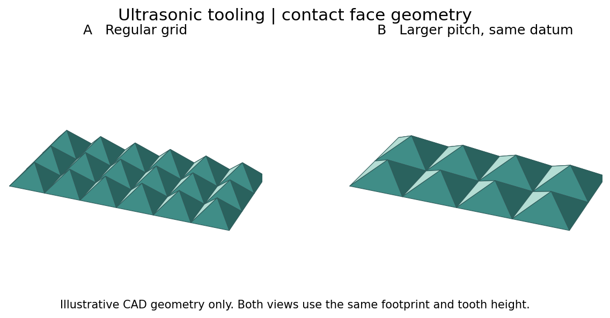
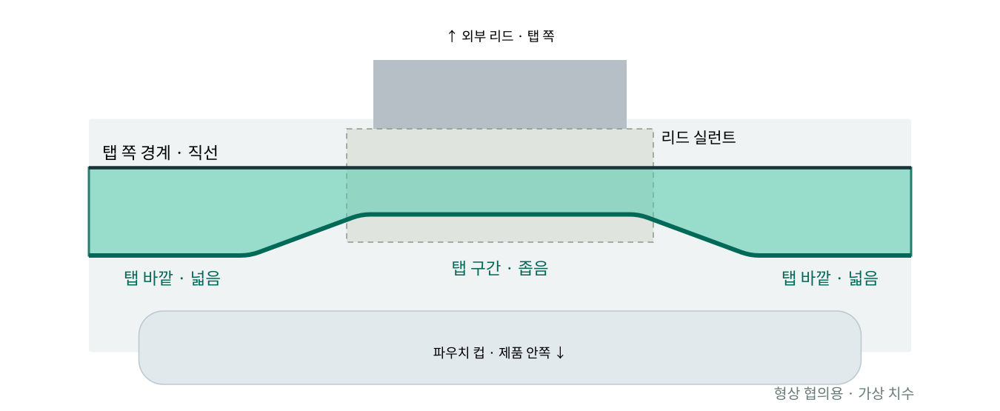

# 접촉면 자료와 구현 근거

1. Shao 등, ASME Journal of Manufacturing Science and Engineering, 138, 051005. Fig. 2(a,b)는 전지 금속 접합에 쓰이는 혼·엔빌의 피라미드형 너링을 제시한다. Fig. 3으로 상하 공구가 접촉하는 방향을 확인한다. 격자형 3D 예제의 근거다. [논문 PDF](https://jhjin.engin.umich.edu/wp-content/uploads/sites/248/2016/01/AP4_ASME_Tool-Wear-Monitoring.pdf)
2. Branson Ultrasonic Horn Catalog의 Knurled Horns 절. 돌출 치와 오목 공동, 피치 등급, 치형 단면 표기가 있다. 여러 용도를 다루는 카탈로그이므로 수록 수치를 배터리 탭 사양으로 지정하지 않는다. [제조사 자료](https://www.branson.emerson.com/is/content/emerson/en/corporate/branson/documents/catalog-ultrasonic-horn-branson-en-us.pdf)
3. Weld Propagation in Ultrasonic Welding of Multi-Layered Dissimilar Metal Sheets, Fig. 4.2. 반구형 배열 혼과 두 종류 피라미드형 엔빌을 비교한다. 두 공구가 독립 형식이어야 하는 근거다. 반구형 신규 편집은 필수 범위 밖이며 기존 정의가 있으면 보존한다. [학위논문 PDF](https://deepblue.lib.umich.edu/bitstream/handle/2027.42/155262/ylyluo_1.pdf?sequence=1)
4. 기존 계약에는 length/width, knurlLength/knurlWidth, pitchU/pitchV, direction, height, tooth와 x/y/rotation이 함께 노출된다. UI·저장 모델·계산 입력의 책임을 점검하고 기존 키 호환성을 유지한다. [기존 코드](https://github.com/playjae0/3D_cell_spec_simulator/blob/bc7259e/src/tooling/contract.js)

같은 예시 영역·치높이에서 피치만 키운 비교다. 실제 공구의 제조 치수와 소재 압흔은 제시하지 않는다.

이 그림은 평면 윤곽의 방향을 나타낸다. 두께 방향 단면은 별도 뷰에서 같은 위치 표시와 연결한다.
