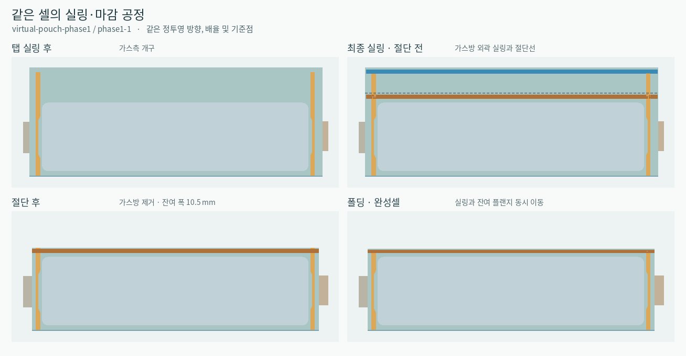

# 1차 공정 개요·탭 실링 검증

실행 코드 커밋 `9d469e5`. R4 병합 `37c668e` 위의 로컬 R5 작업 `415438f`를 이어서 구현했다. 대표 예제는 `virtual-pouch-phase1 / phase1-1`이다. 수치는 mm 단위 가상값이다.

`npm run build` 후 `scripts/start.*` 또는 CadQuery가 설치된 환경의 `python cad/server.py`로 실행한다. 첫 화면의 **공정 한눈에 보기**에서 전극 조립·탭 용접, 파우치 성형·수납, 패키지 실링·마감의 13개 고정 CAD 카드를 확인한다. 카드와 상세가 같은 CAD 응답을 사용한다. **공정 한눈에 보기**로 돌아오면 모델·개정과 공정 선택을 유지한다. 입력이나 공구 개정이 달라지면 카드 기록을 새 설계로 갱신한다. [첫 화면](evidence/overview.png)

**탭 실링 후 → 파우치 CAD 계산 → 양극/음극 탭 실링 확대·치수**에서 컵 입구, 리드, 실런트와 실제 제품 실링 경계를 확인한다. **요소기술 → 실링바 평면 윤곽**에서 L 또는 R을 입력하고 CAD 미리보기를 적용한다. 기본은 같은 극의 상하 바를 함께 편집한다. 개별 바를 편집하면 결과에서 중첩을 제한하는 바와 제품 접점·원호의 성립 여부를 확인할 수 있다. **요소기술 → 한 장 필름·가스방**에서 절단선 Y를 편집한다. 레거시 두 장 필름 공정은 **기존 파우치 예제 열기**에 있다.

네 카드는 같은 원점, 정투영 방향 및 배율을 사용한다. 황색은 탭측 실링, 청색은 가스방 외곽 실링, 갈색은 몸체 쪽 최종 실링이다. 점선은 절단선이다. R6에서는 잘린 가스방과 그 외곽 실링이 제품에서 제외된다. R7에서는 남은 플랜지와 실링이 함께 접힌다.

양극 확대도 [탭 실링 후](evidence/tab-original.png) · [기본 완성셀](evidence/tab-folded.png) · [L만 42 mm](evidence/tab-L42.png) · [R만 5 mm인 완성셀](evidence/tab-R5-folded.png)

| 독립 변경 | 양극 접점 간 L | 양극 원호 R | 양극 폭 왼쪽/중앙/오른쪽 | R7 양극 잔여 재료 평면 기준 면적 |
|---|---:|---:|---:|---:|
| 기본 | 38.000 | 3.000 | 5.000 / 3.000 / 5.000 | 388.167 mm² |
| L만 변경 | 42.000 | 3.000 | 5.000 / 3.000 / 5.000 | 380.167 mm² |
| R만 변경 | 38.000 | 5.000 | 5.000 / 3.000 / 5.000 | 386.279 mm² |

음극 CAD 기준은 세 경우 모두 L 36.000, R 2.500, 폭 4.800/3.000/4.800 mm였다. 폭을 비교한 바깥 위치는 해당 리드 중심 기준 U=±35 mm다. 두 단계의 접점과 반경은 실제 제품 BRep 경계에서 읽었다. R7 측정점은 실링 재료가 이동한 좌표에 연결했다. 소스 수치 검산은 `python scripts/check_phase1_measurements.py`로 실행한다. [CAD 원시 측정값](evidence/cad-measurements.json)

| 절단선 Y | 절단 전 컵 기준 여유 폭 | 절단 후 평면 잔여 폭 | 폴딩 후 상부 필름 끝 (Y, Z) |
|---:|---:|---:|---:|
| 50 | 40.5 | 10.5 | (47.155, 3.294) |
| 52 | 40.5 | 12.5 | (47.502, 5.264) |

컵 +Y 기준은 39.5, 절단 전 필름 끝은 Y=80, 접힘선은 Y=46, 접힘 각도는 80°다. 절단선만 옮긴 시험에서 절단 전 필름과 실링, 양·음극 금속 리드의 체적과 공정별 리드 위치를 유지했다. 양쪽 필름의 실제 절단 경계와 폴딩한 탭 실링 끝이 필름 표면에 닿는지 CAD로 검사했다. R=15 mm는 접선 직선 구간을 없애므로 오류를 표시하고 마지막 확정 형상을 유지한다.

검증 환경은 Linux, Chromium, CadQuery 2.7.0이다. JavaScript 79개, 기존 CAD 48개 및 신규 CAD 4개가 통과했고 일반 빌드가 성공했다. Chromium에서 13개 카드, 동일 모델 상세/개요 복귀, L·R 변경과 거부, 절단선 변경, JSON 저장·재열기, 앞 공정 복귀, 기존 P·R4 파일을 확인했다. 재검수에는 `python scripts/check_phase1_browser.py http://127.0.0.1:8765/ /tmp/phase1-proof`를 사용한다. 기본 브라우저와 다른 Chromium은 `POUCH_CHROMIUM`으로 지정한다.

외부 Sites의 현재 게시본은 활성 상태인 [파우치 셀 v1.2 CAD 검토판](https://pouch-cell-review-v12.goodlycurio3.chatgpt.site)이다. 1차 검증은 로컬 앱에서 수행했다. 1차의 정적 프리뷰 전체 재검수 및 외부 게시, Windows·iPad 실기, 실제 융착·가스·재료 물성 해석은 검증 범위에 포함되지 않았다.
