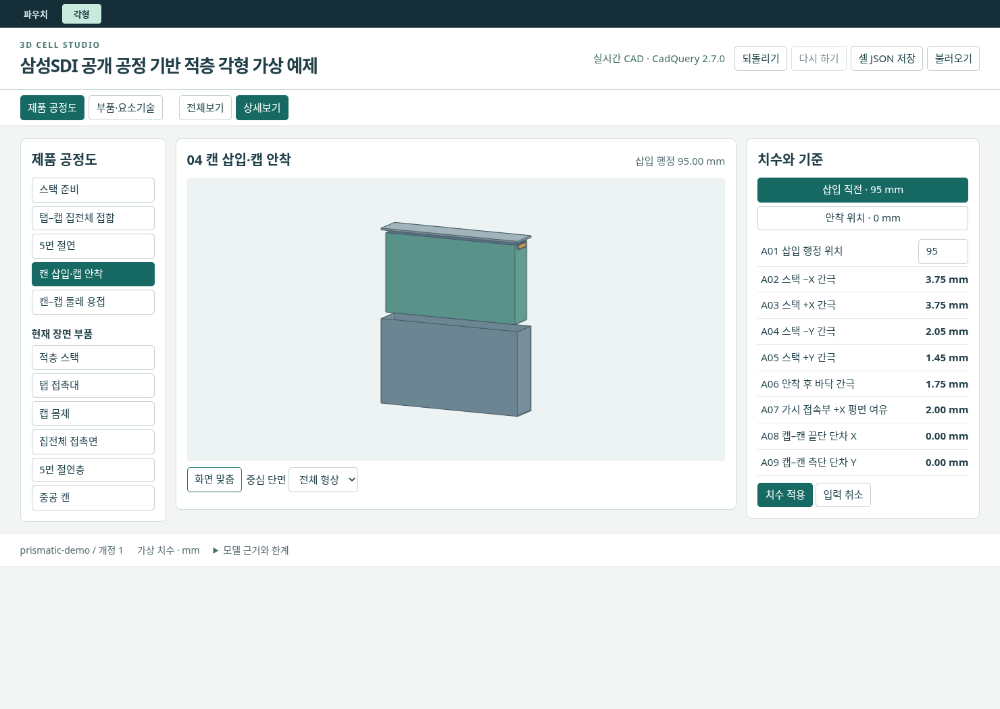
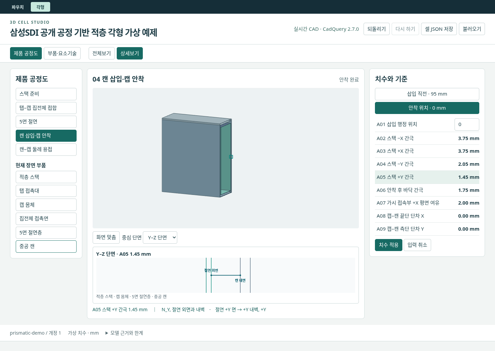
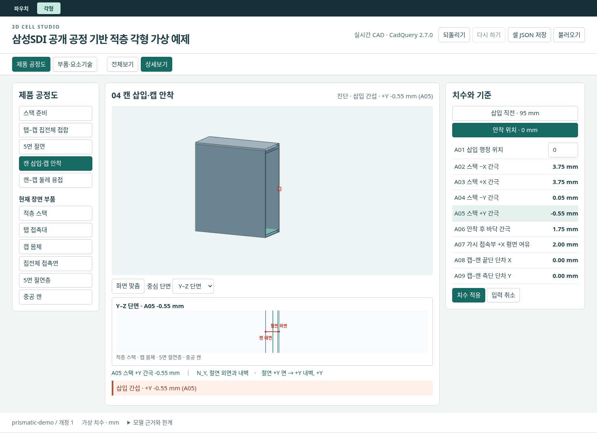

# 적층 각형 검수 안내

삼성SDI 공개 공정 기반 적층 각형 가상 예제입니다. 치수는 모두 mm 단위 가상값입니다. 스택 수와 극별 내부 연결, 반대편 집전체, 용입 형상은 확인되지 않았습니다. BMW iX Gen.5는 완성 외관의 참고 자료입니다. 캡 아래의 가시 집전체는 접촉면으로만 표현합니다.

## 기준과 편집 위치

| 화면 | 독립 입력 | CAD 검사 |
|---|---|---|
| 스택·탭 단품 | S01–S07 | 중심 S_X/S_Y와 스택 상면 S_A. S02는 S_Y 양쪽으로 변함 |
| 캡·집전체 단품 | K01–K07 | K_A 아래의 가시 접촉대. J_X=T_X로 X 위치가 결정됨 |
| 제품 공정도 02 접합 | J01·J02 | J03 편심, J04 높이 겹침, J05 폭 겹침. 겹침 소실 시 접합 불성립 |
| 절연 단품 | I01·I02 | 공정 03에서 I03–I05. 상면은 열려 있고 측면 상단 후퇴만 조절 |
| 중공 캔 단품 | C01–C05 | 캔 개구 N_A는 Z=0. 벽 네 면과 바닥이 있음 |
| 제품 공정도 04 삽입 | A01 | A02–A07 간극과 A08·A09 외주 단차. 캡·집전체·탭·스택·절연층이 함께 이동 |
| 제품 공정도 05 표시 설정 | W01 | W02는 직각 외주 중심선 길이. 접합·안착 및 양방향 단차 검사 통과 시 표시 |

측정 항목에 마우스나 키보드 포커스를 두거나 터치하면 측정 양끝과 기준 방향이 표시됩니다. 내부 간극은 CAD 단면과 국부 확대에서 확인합니다. A02–A05는 평면 투영값, A06은 안착 가정의 바닥 간극, A07은 접촉면의 +X 여유입니다. 캡과 캔 외주 단차 판정의 수치오차는 0.0000001 mm입니다.

간섭 상태의 제안 위치도 형상을 살펴볼 수 있습니다. 화면은 진단과 간섭 방향을 표시하고 안착 승인 및 용접 표시를 차단합니다. 직벽 캔과 직선 삽입을 가정한 프록시의 검토 범위이며, 코너·절연 이음·감춰진 접속부의 양산 삽입성은 별도 확인이 필요합니다.

## 검수 화면

| 삽입 직전 · A01 = 95 | 안착 후 · A05 = 1.45 | 간섭 · A05 = −0.55 |
|---|---|---|
|  |  |  |

기본 S02 28에서 30으로 바꾸면 스택 양쪽 면이 각각 1 mm씩 이동합니다. 외폭은 28.50→30.50, −Y/+Y 간극은 2.05/1.45→1.05/0.45입니다. S02 32, J02 10, K02 34의 실패 시험은 각각 기본 셀에서 새로 시작합니다.

## 재현

기존 설치 절차로 CadQuery와 웹 의존성을 준비한 뒤 저장소 루트에서 실행합니다.

```sh
npm test
python -m unittest discover -s tests -p '*geometry*.py'
npm run build
sh scripts/start.sh
```

별도 터미널에서 `python scripts/check_prismatic_browser.py http://127.0.0.1:8765 --chromium /usr/bin/chromium`을 실행합니다. 브라우저 검수에는 Python Playwright가 필요합니다. 브라우저 경로는 설치 위치에 맞게 지정하거나 Playwright 기본 Chromium을 사용합니다. 정적 검수판을 별도 포트로 제공한 뒤 같은 명령에 해당 주소와 `--preview`를 지정합니다. `--screenshots <폴더>`는 검수 화면 세 장을 저장합니다.

셀 JSON은 제품 타입, 단위, 모델 ID·개정, 공정과 독립 입력을 저장합니다. 치수 계산값은 다시 열 때 기존 CAD 요청 검증 경로에서 재생성합니다. 정적 검수판은 동일 설계·개정의 실제 CAD 기록만 복원합니다.
