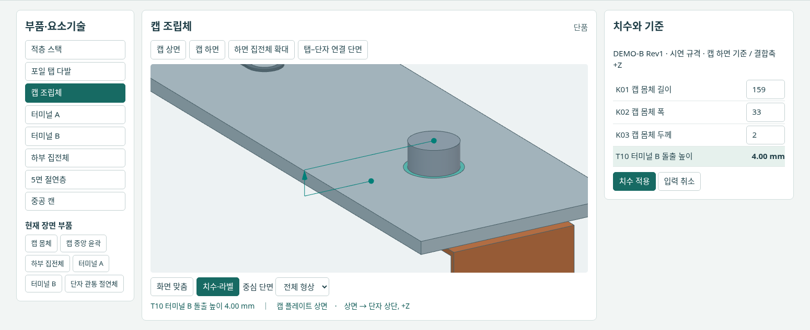
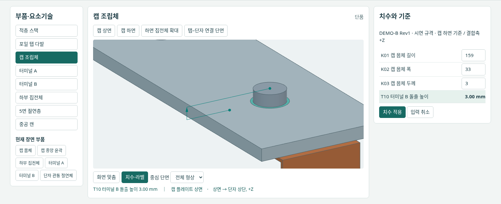

# DEMO-B Rev1 고정 단자와 T10 검수

기준은 PR #17을 병합한 main `af66ab0bc6efac393298d09ce7c76138347a15d0`이다. Linux에서 빌드한 앱을 Chromium으로 열고 로컬 CadQuery 2.7.0 서버로 재계산했다. 아래 화면은 이번 실행에서 캡처했다. 길이 단위는 mm, 체적 단위는 mm³이다.

## 앱에서 재현하기

1. 개발 환경에서 `scripts/start.sh`로 앱을 열고 **각형 → 제품 공정도 → 전체보기 → DEMO-B Rev1 · 고정 단자**를 선택한다.
2. 캡 조립체의 **T10** 행에 포인터나 키보드 포커스를 놓으면 캡과 단자가 함께 보이며, 두 실측점과 외부 수직 치수선이 확대된다.
3. **K03 캡 몸체 두께**를 2에서 3으로 바꾸고 **치수 적용**을 누른다. 같은 단자에서 T10이 4.00에서 3.00으로 바뀐다.
4. **셀 JSON 저장** 후 다시 열고 **부품·요소기술 → 캡 조립체**를 선택하면 K03과 계산된 T10을 확인할 수 있다. 기존 **특허 참고 캡 조립체 → 터미널 B**에는 사용자 지정 T10 입력이 있다.

## 구조와 시연 규격

도 2·4·5와 [0032]의 플랜지 22a, 돌기 22d, 수평판 42a, 고정 구멍 42b와 측판 42d의 연결 관계를 PR #17의 결합에 대조했다. 돌기가 들어가는 곳은 42b이며 42e는 별도의 퓨즈 구멍이다. 결합에는 기존 CAD 생성 함수를 사용한다. 고정 단자에만 돌기 길이와 집전체 구멍 깊이를 별도로 지정한다. [EP2581968A1 원문](https://data.epo.org/publication-server/rest/v1.2/publication-dates/20130417/patents/EP2581968NWA1/document.pdf)

시연 규격 ID는 DEMO-B, 개정은 1, 배치 기준은 캡 하면, 결합축은 +Z다. 단자 베이스 길이 26, 폭 15, 캡 하면에서 단자 상면까지 6, 돌기 길이 0.8은 모두 **가상 시연값**이다. 조립된 금속 평면과 원판 평면 사이의 +Z 높이 차로 T10을 계산한다. JSON에는 규격 참조와 배치·캡 입력을 보관한다. 캡 두께의 지원 범위는 0 초과 6 미만이다. 새 예제의 절연 상단 후퇴량 I02는 포일 집속부와 절연층이 겹치지 않도록 6으로 두었다.

## 실측과 판정

| 검수 | 기대 | 관찰 | 판정 |
|---|---|---|---|
| K03 2 → 3 | 같은 단자의 상면 고정 | 캡 금속 상면 Z 2 → 3, 단자 상면 Z 6 → 6. CAD와 앱의 T10 4.00 → 3.00. 단자 체적 양쪽 688.736009 | 통과 |
| 보조선 시작과 끝 | 두 실면의 내부에 접촉 | 시작 (56, −10.425, 2 또는 3), 끝 (56, 0, 6). 면까지 각각 0.000, 가장 가까운 모서리까지 6.075와 3.750. 외부 치수선 Y = −21.500 | 통과 |
| 삽입 행정 +45 | 조립 이동에 치수점이 따라감 | K03 3에서 접점 Z 48과 51, T10 3.00 | 통과 |
| 기본 안착과 체적 간섭 | 부품 간 양의 교차 체적 없음 | K03 2·3에서 각각 안착 승인. 12개 솔리드의 66쌍씩 검사, 최대 교차 체적 0 | 통과 |
| K08과 A07 구분 | 접촉면 여유가 양수라도 실제 침범은 차단 | 측판 두께 K08 0.80 → 2.50, 접촉 기준면에서 캔 내벽까지 A07 +2.00 유지. 집전체가 +X 방향 0.50 침범, 캔과의 교차 체적 74.00, 안착 차단 | 통과 |
| 탭 X 분리 | 투영이 겹쳐도 실제 접촉이 없으면 접합 불성립 | CAD 시험에서 탭을 −X로 0.25 이동. 실거리 0.25, Y/Z 겹침 18.00/4.00. 접합 거짓, 접촉·접합 오버레이 모두 0개 | 통과 |
| 각형 저장과 재열기 | 기존 사용자 지정과 고정 규격 모두 복원 | 기존 특허 예제 T10 4 → 5 편집·복원. DEMO-B K03 3과 규격 참조 복원 후 T10 3.00 재계산 | 통과 |
| 파우치 회귀 | 치수 편집, 공정 전환, 기존 파일 열기 | 양극 리드 폭 36 → 37, 조립 공정 열기, 공개 예제 JSON 불러오기. 기존 각형에서도 파우치 전환 후 복귀 | 통과 |

[CAD 실측 원문](measurements.json)

| 캡 두께 2 · T10 4 | 캡 두께 3 · T10 3 |
|---|---|
|  |  |

[기존 특허 예제의 캡 하면](01-original-cap.png) · [고정 단자의 캡 하면](02-demo-b-underside.png) · [결합축 단면](03-coupling-section.png) · [집전체 단품](04-collector.png)

## 시험 재실행

```sh
npm run build
npm test
python -m unittest discover -s tests -p '*geometry*.py' -v
# 로컬 CAD 앱을 실행한 뒤 다음 두 명령에 해당 주소를 사용한다.
python scripts/check_prismatic_browser.py http://127.0.0.1:8765 --chromium /usr/bin/chromium
python scripts/check_demo_b_browser.py http://127.0.0.1:8765 /tmp/demo-b-evidence --chromium /usr/bin/chromium
```

검수 범위는 예시 규격과 로컬 브라우저·CAD 조립 모델이다. 실제 제품 치수와 제조 공차, 실물 조립성, 사내 PC 환경은 미검증이다.
