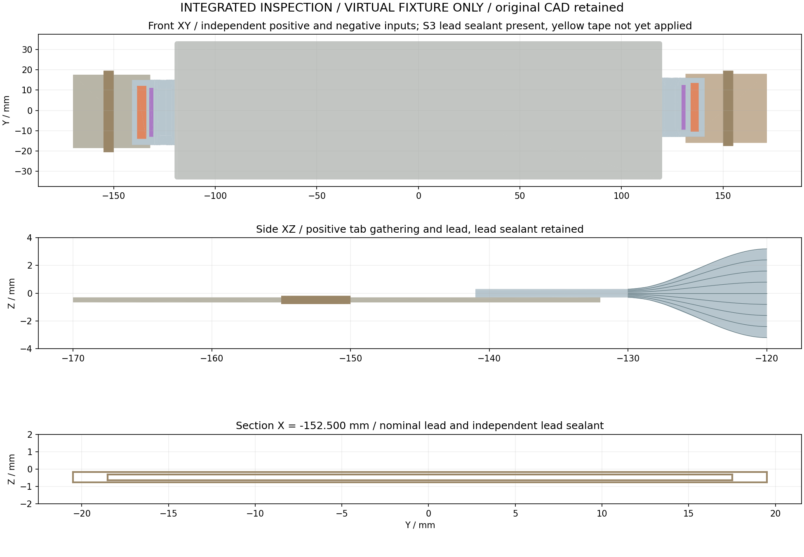

# v1.4 통합 검증 기록

검증일 2026-11-18 KST. 기준 main `4df91c9efdb2db4bf3c001ee6c1ef02cf1524837` / 병합된 PR #4. 별도 작업 브랜치 `feat/inspection-compare-integrated`. 기존 사용자 작업 폴더와 읽기 전용 리뷰 사이트는 수정하지 않았다. 최종 검토 코드는 이 문서를 포함하는 PR의 HEAD로 고정한다 (`git rev-parse HEAD`).

## 실행 환경과 결과

Linux 개발 환경, Node.js v24.22.1, Python 3.12, CadQuery 2.7.0. 개발 웹 빌드 후 `POUCH_PORT=8768 python cad/server.py`로 실제 CAD 서버를 실행했다. 실측/기밀 데이터 없이 저장소 가상 입력만 사용했다.

| 검사 | 실제 결과 |
|---|---|
| `npm test` | 57/57 통과. 기존 42개 + 의미 있는 통합 회귀 15개 |
| `python -m unittest discover -s tests -p '*geometry.py' -v` | 28/28 통과. 기존 25개 + 실런트 회귀 3개. 86.973초 |
| `npm run build` | 통과. 210 모듈. 기존 큰 번들 경고는 유지 |
| `python scripts/check_api.py http://127.0.0.1:8768` | 기존 7공정, 실제 치수 변경/극 독립, 요청 ID, 불가능한 입력 422 통과 |
| `node scripts/check_intake_api.mjs http://127.0.0.1:8768` | 희소 S0, µm 정규화, 실제 독립 CAD, 요청 정체성 통과 |
| `node scripts/check_integrated_api.mjs http://127.0.0.1:8768` | 실제 S3/공정 비교, 독립 극 치수, 저장 복원, 실측 방어, 기존 보관함 병합 통과. [기계 판독 결과](validation-integrated/api-results.json) |
| `python scripts/render_integrated_proof.py` | 실제 CAD 정면·측면·단면 이미지 생성 및 직접 열어 확인 |

기존 JS 2개의 기대값은 오류를 없애는 방식이 아니라 새 오류 코드와 명시적인 무효 앵커 상태를 확인하도록 갱신했다. CAD 생성 알고리즘·상세 파우치·STEP 입출력은 확장하지 않았다. 기존 CAD 회귀에 포함된 STEP 재열기 검사는 통과했다.

## 인수 기준 A–E

| 범위 | 확인한 결과 | 검증 층위 |
|---|---|---|
| A 실런트 | S3 실런트 존재/노란 테이프 부재, S4 유지, 양극 길이 변화에 음극 불변, 테이프 제거와 독립, S2 부재, source 불변, 1.0 미입력 null/경고 보존 | CAD 회귀·실제 API·JSON 왕복 |
| B 검사 개정 | 제공 F1/F2를 수정 전 재현. 원점 −1→−11, 프레임 회전, 고정 앵커 이동, 공차/조건 변경의 이전 개정 실측 차단. 카메라/표시 허용. 데이텀/앵커/검사/부품/출처 차이 및 순서 무시 | JS·실제 API |
| C 측정 연결 | 유효 참조 기반 세트·중복 방지, 공정 부재/참조 소실/범위 이탈/미확정 구분, 프리셋 JSON 왕복과 다른 모델 참조 검증 | JS·실제 API. 사용자 화면 선택 흐름은 아래 별도 기록 |
| D 비교 | 독립 스냅샷·취소/지연·캐시, S2/S3 리드 부재 구분, 양극만 실제 CAD 변경, 데이텀만 다르면 형상 재사용/직접 Δ 차단 및 공통 프레임 재계산 | JS·실제 API. 동기 카메라의 화면 조작은 아래 별도 기록 |
| E 복원 | 비어 있지 않은 보관함 중복·새 개정·충돌, 복사 부모/샘플/프리셋 매핑, 초안만 있는 파일, 원본 보존, 저장 실패, 손상 저장소 복구 실패, 부모 누락/순환 차단 | JS·실제 API. 실제 파일 선택은 아래 별도 기록 |

### CAD 정면·측면·단면

가상 제품의 S3다. 위는 XY 정면, 가운데는 양극 탭–리드의 XZ 측면, 아래는 실런트 중심 X=-152.5 mm 단면이다. S3에서 노란 테이프가 생성되지 않으며 리드와 별도 실런트가 남는다. 포일은 유한한 집속 구간으로 모이고 기존 가정 실런트 단면을 유지한다. 이미지가 실물 단면 또는 물리 변형 검증을 의미하지 않는다.

## 최종 UI 확인 상태

사용자가 화면 실행 요청을 최종 단계로 미뤄 달라고 했으므로 구현·자동 검사·실제 API를 먼저 수행했다. 마지막에 작업용 로컬 앱에서 가상 JSON 파일 선택과 아래 흐름 검증을 요청한 상태다. 이 문서 작성 시점에는 이번 버전의 실제 파일 선택/브라우저 조작을 완료로 기록하지 않는다. API의 JSON 왕복은 실제 업로드 UI 검증과 다르다.

허용 후 재현 절차:

1. `http://127.0.0.1:8768`의 전체 개발 앱에서 모델/입력 양식 열기. `examples/intake/virtual-complete.json` 파일을 선택한다.
2. 검토표의 가상 출처/입력·S3 생성 가능 상태 확인 → S3 임시 CAD → 적용. 적용 전과 취소에서는 기존 작업 유지 확인.
3. 치수·스펙에서 현재 공정 기본 측정 세트 추가. 같은 버튼을 다시 눌러 중복이 없는지 확인. 측정 선택으로 대상·방향·프레임 가이드를 확인한다.
4. 프리셋 이름 지정 → 검사 보기 저장 → 현재 작업을 새 개정 저장. 단면·카메라·숨김을 바꾼 뒤 프리셋 복원 확인.
5. 전체 보관함 백업 다운로드 → 기존 보관함에 파일 재가져오기 → 중복 요약 확인 → 적용 → 새로고침 → 개정 재열기 → 검사/프리셋 복원 확인.
6. A/B 공정 비교에서 S2/S3 선택, 공통 정면/측면과 단면 확인. 비교 종료 후 원래 작업·카메라·선택이 유지되는지 확인.
7. 검사 기준 원점 Y만 10 mm 이동한 뒤 기존 개정 실측 저장이 차단되는지 확인. 새 개정에 저장하면 기존 실측은 원래 개정에 남는다.

## 변경 파일과 유지한 제한

- `cad/process.py`, `cad/model.py`: 실런트 시점·미확정 참조·폭 기준. 기존 CAD 재사용.
- `src/intake/`, `scripts/generate-intake.mjs`, `examples/intake/`, `docs/intake/`: 1.1 계약·조건·생성 파일, 1.0 호환, 검사 보기/조건 전달.
- `src/annotations/{semantics,sets,presets,panel,anchors,measure}.js`: 검사 의미·세트·가이드·보기·오류.
- `src/models/{library,merge,storage,compare,compare-panel,panel}.js`, `panel.css`: 개정/실측 방어, 안전 병합·복구, 독립 비교 UI.
- `src/main.js`, `src/viewer/viewer.js`, `src/data/`, `index.html`: 기존 화면 연결과 프레임 가이드, 저장/포커스 복원.
- `tests/integrated.test.js`, `tests/integrated_geometry.py`, `tests/run.js`, API/증빙 스크립트: 추가 검증.
- README, 현재 명세/계획/검증, Copilot 안내, 패키지 버전 1.4.0.

사내 Windows·실제 제품 데이터·iPad·완전 오프라인 설치 실기는 미검증이다. 곡면/실루엣 앵커, 임의 형상 도면화, 실링바/리드 통과부 국부 성형 및 새 파우치 배치는 미지원이다. 프리셋의 교차 모델 적용은 엄격한 참조 검사를 통과해야 한다. 부품 비교의 외곽/체적 동일은 모든 국부 형상이 같다는 판정이 아니다. 실행파일/설치/배포 갱신은 요청 범위에서 제외되어 수행하지 않았다.
