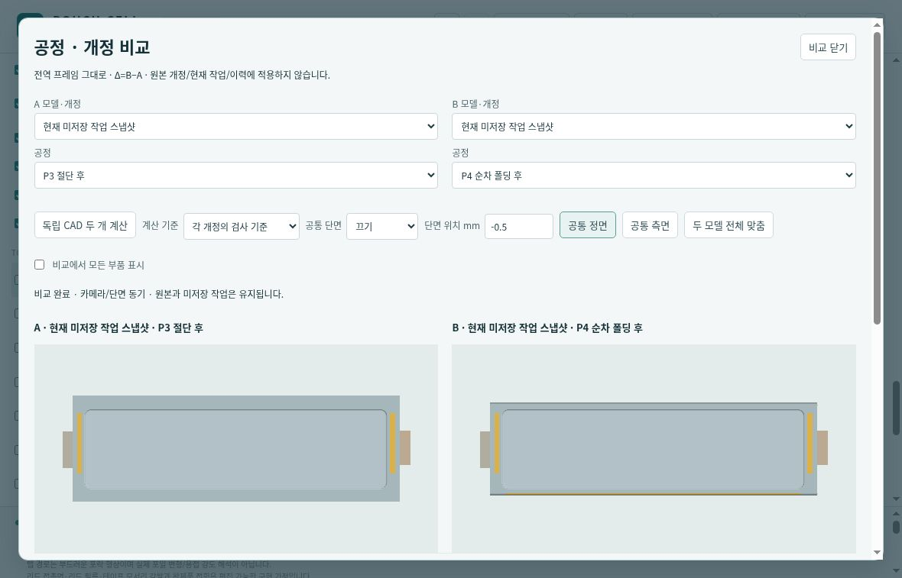
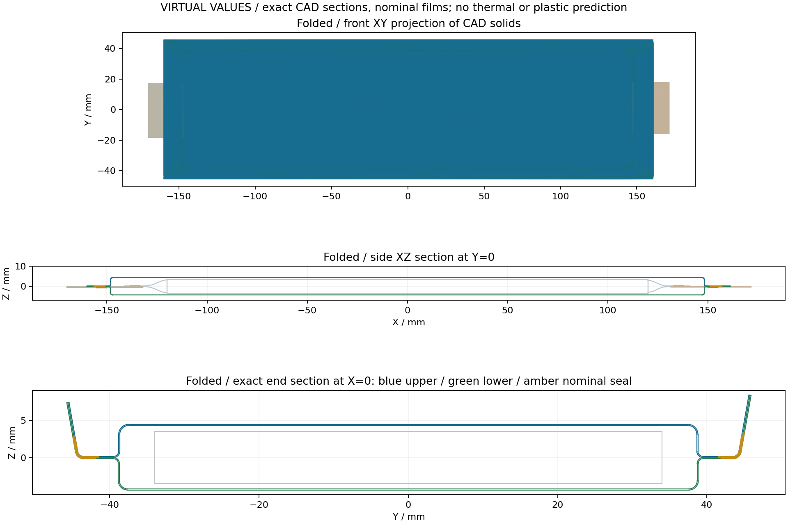
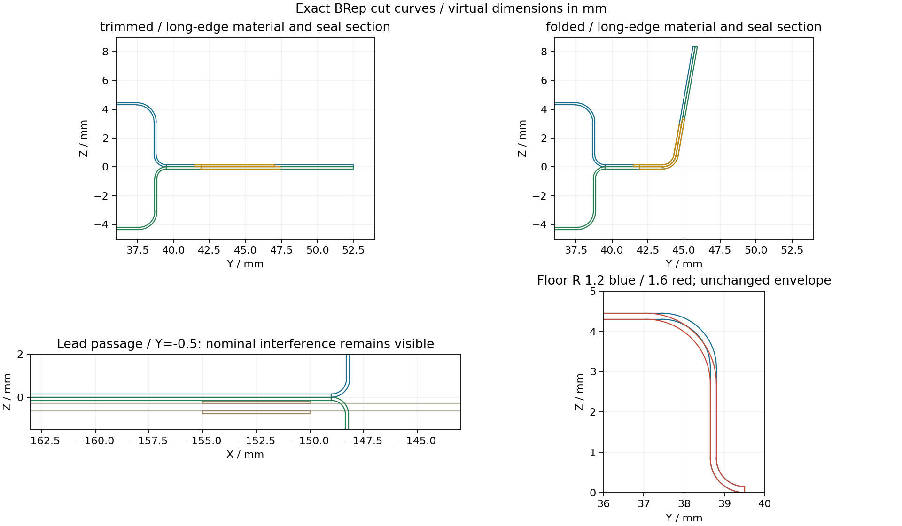

# v1.5 파우치 공정 구현·검증

2026-11-18 UTC. 작업 시작 main `cde0950f6255c946524b05973619750b0e123522` (PR #6 기능 수정 + #7 검토 이미지). ZIP의 검토 기준 `644f723` 이후 변경을 보존했다. 원래 탭 집속·테이프 CAD를 다시 설계하지 않았다. 새 형상은 `pouchProcess`가 있는 가상 예제에서 명시적으로 사용한다.

## 실제 구현

- 조립체 없는 성형 외장 → S4 조립체 수납 → 공칭 실링 영역 → 실제 CAD 절단 → 유한 두께 순차 접힘. 기존 stage ID와 구 입력 1.0/1.1은 별도 호환 경로로 유지한다.
- 상하 독립 포켓의 깊이·내면 개구·바닥/림/평면 R·공칭 필름 두께. 조립체의 6자유도 강체 배치와 실제 BRep 표면의 방향 간극·교차 체적.
- 상하/네 변 8개 작업면의 위치·길이·폭·코너 R·선택형 relief, 제품 실링 영역과 상하 공통 영역. 작업면 표시·숨김·선택과 소유 입력 연결.
- 재료 좌표의 절단 경계, 위치별 잔여 폭, 절단 소실 참조의 무효화. 긴 변마다 두 개까지의 접힘, 유한 반경 호와 평면, 기준층 길이 보존, 재료를 따라가는 실링 영역·기준점.
- 실런트와 실제 작업면의 최소 거리, 실제 작업면 경계와 교차한 XY 중심선 겹침/끝단 거리. XY 투영 겹침은 실제 접촉이나 융착을 의미하지 않는다. 기존 실런트 길이·폭·리드 대비 돌출·위치 항목을 유지한다.
- 새 입력 사전 141개, intake 1.2, 기본 검사 세트, 도면식 치수, 검사 보기·개정·실측·A/B·JSON에 연결. 국부 곡면 변화를 감지하는 면 서명을 추가했다.

범위와 기준 정의는 [상세 명세](spec-pouch-v1.5.md), 근거 적용/제외는 [출처 기록](evidence-pouch-v1.5.md)에 있다.

## 자동검사

환경: Linux, Node.js 24.22.1, Python 3.12, CadQuery 2.7.0 / OCP. 실제 사내 Windows 결과는 아니다.

| 검사 | 결과 |
|---|---|
| `npm test` | **65/65 통과**. 기존 59개 + 공정 계약/구 입력 호환/새 필드 참조/곡선 재료 앵커/회전 대응 면 두께/국부 A-B 변화 6개. |
| `python -m unittest discover -s tests -p '*geometry*.py' -v` | **40/40 통과**. 기존 28개 + 새 CAD 12개. [전체 로그](validation-pouch-v1.5/cad-tests.txt). |
| `node scripts/check_pouch_api.mjs http://127.0.0.1:8769` | 실제 HTTP CAD API 9회. 다섯 공정 생성, 235개 검사 중복 방지, intake 왕복 후 동일 geometryId, 검사 보기/비어 있지 않은 보관함 병합, 개정 실측 보호, 상부만 변경한 A/B, 오류 422 후 정상 복구. [상세 결과](validation-pouch-v1.5/api-results.json). |
| `npm run build` | 통과, 216 모듈. 기존 단일 번들 크기 경고는 남아 있다. 패키징 최적화는 이번 범위 밖이다. |
| STEP | 새 folded 모델의 물리 솔리드만 mm로 내보낸 뒤 OCC 재가져오기. 유효성·솔리드 수·체적·정확한 외곽 치수 일치. 표시 영역/설비 작업면은 제외. |
| 표시 메시 독립성 | 두 테셀레이션 정밀도에서 feature/치수 동일. OCC의 캐시 메시가 아닌 `AddOptimal(..., useTriangulation=False)`로 새 CAD 외곽 계산. |

CAD 회귀에는 상부 깊이만 변경, Y 이동 시 양측 간극 반대 변화, 강체 회전 후 면·법선·패치 추종, 작업면 독립/홈/공통 면적, 실제 절단 체적과 참조 소실, 실링 영역을 가로지르는 접힘, 동일 외곽의 바닥 R 변경, 복수 접힘·잘못된 순서/R 거부, 상하 서로 다른 절단 길이, 0° 접힘과 실제 내측 반경을 포함했다. 입력을 조용히 보정하지 않는 것도 검사한다.

검사 도중 발견한 문제는 수정 후 재검사했다. 기존 7단계 회귀가 새 단계까지 구 예제로 생성하려던 테스트 범위를 명시적으로 분리했고, 새 5단계는 별도 CAD 회귀로 덮었다. 실링 폭을 줄여도 실런트가 여전히 전부 덮이는 경우에는 겹침이 변하지 않는 것이 올바르므로, 회귀 입력을 실제 경계가 통과하는 변경으로 바꿨다. 저장 왕복 비교는 선택 속성의 누락과 기본값(`null`, 빈 문자열)을 동일하게 정규화하며 실제 정의·값·표시·기준·설명을 모두 비교한다.

## 실제 화면 검증

전체 앱을 `POUCH_PORT=8769 python cad/server.py`로 실행했다. Cloud Chrome 1180×757은 WebGL context를 만들지 못해 **기존 CPU CAD 미리보기**로 동작했다. 실시간 CadQuery API 연결은 확인했다. WebGL/Windows/iPad 검증으로 기록하지 않는다.

| 조작 | 확인한 결과 |
|---|---|
| 가상 파우치 공정 예제 | P2 공칭 실링 영역 열림. 상하 포켓·외곽·내부 부품을 표시. |
| P0 성형 상태 | 조립체 없이 상하 포켓/외곽 네 부품만 존재. |
| 상부 깊이 변경 | 4.3→5.0 mm 입력 후 실제 CAD 확정. 가이드 5.000 mm, 하부 4.2 mm 유지. 끝면/단면 확인. |
| 불가능한 입력 | 깊이 0.1 mm는 ‘깊이는 바닥 R+림 R보다 커야 합니다’와 미적용 상태 표시. 마지막 5.0 mm 형상을 유지하고 Escape로 복구. |
| P4 폴딩 및 측정 | 기본 세트 235개 추가, 재추가 0개. 전체 숨김·검색 사용. |
| 저장·실제 파일 재열기 | 검사 보기 ‘폴딩 정면 검토’를 저장하고 셀 JSON 다운로드. 새로고침 후 실제 파일 선택기로 그 파일을 재열었다. P4, 검사 235개, 상부 5.0/하부 4.2, 검사 보기 1개를 복원했다. 보기 적용 후 정면/숨김/단면 상태 복원. |
| 리드 통과 단면 | 양극 중심 프리셋을 선택해 Y=-0.50 단면과 XZ 측면 확인. 임의 3D 회전 후 프리셋도 전역 Y 평면이며 리드 법선 단면으로 자동 바뀌지는 않는다. |
| 작업면 선택·숨김 | `upper_xMinus` 작업면 체크/선택/숨김. 소유 입력과 실링 폭 기준/영향 안내로 연결됨. |
| A/B | P3 절단 후 / P4 폴딩 후 독립 CAD 생성. 공통 정면으로 외곽 폭 변화 확인. 원본 작업을 유지한다는 완료 상태 확인. |

실제 화면 검사에서 새 치수 가이드에 표시값이 없을 때 `toFixed` 예외로 입력이 중단되는 오류를 발견했다. CAD에서 계산한 가이드 값을 사용하도록 고치고 깊이 변경/오류 복구를 다시 확인했다. CAD 확정 전의 기존 참조는 ‘마지막 확정’으로 표시한다. 새 조작 패널의 제목 겹침을 수정했고, 검사 탭에서는 이전 설계 입력 가이드를 해제한다.

기존 입력 검토→임시 CAD→적용/취소, S3 실런트, 비어 있지 않은 보관함 UI 병합·개정 재열기와 실측 보호는 [직전 전체 앱 화면 검증](validation-ui-v1.4.md)의 선행 증빙을 유지한다. 이번에 그 모든 UI 분기를 재실행했다고 주장하지 않는다. 새 파우치의 intake/보관함/개정/실측은 위 실제 API 통합검사에서 추가 검증했다. 파일 선택 도구에서 약 2분 대기가 있었으나 업로드와 앱 복원은 완료됐다.

### 화면과 CAD 단면 자료

- [성형 상태·깊이 가이드](validation-pouch-v1.5/ui/01-formed-section.jpg)
- [JSON 복원 후 폴딩 정면](validation-pouch-v1.5/ui/02-folded-front-restored.jpg)
- [리드 통과부 측면 단면](validation-pouch-v1.5/ui/03-lead-side-section.jpg)
- [절단/폴딩 A-B 비교](validation-pouch-v1.5/ui/04-trim-fold-compare.jpg)

아래 공학 그림은 `python scripts/render_pouch_proofs.py`로 재현한다. 정면 투영은 CAD 메시, 단면은 실제 BRep와 평면의 교선이다. UI 스크린샷이나 실제 제품 사진으로 표현하지 않는다. 그림은 원래 가상 예제(상부 깊이 4.3), UI 편집 검증은 상부 5.0을 사용하므로 구분한다.

## 가정·미지원·다음 검토

1. 모든 값은 가상이다. **분리 두 장 / 상하 이중 컵 / 수직 벽 / 평행 긴 변 접힘**을 지원한다. 단일 컵, 한 장 연결 외장, 경사 벽, 단변/교차 접힘은 차단한다. 둥근/홈 작업면이 절곡 구간을 가로지르는 조합도 명시적으로 거부한다.
2. 예제 gap=0에서는 양극·음극 리드와 하부 외장 간섭이 각각 약 **2.16965 / 1.61719 mm³**로 검출된다. 숨기거나 부품을 축소하지 않는다. 공칭 gap을 키워 간섭을 없애는 것은 실제 압착·밀봉이 완료됐다는 뜻이 아니다. 리드 주변 국부 외장 경로와 실제 압착 두께는 후속 제품 정의가 필요하다.
3. 지정 기준층 길이를 보존하는 명목 절곡이다. 다른 층의 실제 연신/주름/스프링백, 성형 감육, 수지 유동, 열융착 강도는 계산하지 않는다. 공칭 실링 영역은 제품 재료와 작업면의 교집합이다.
4. 자유점은 등록 평탄 패치와 파우치 긴 변 재료 패치에 한정한다. 임의 곡면 클릭/임의 컷아웃/접힘 토폴로지 편집은 미지원이다. 일부 작업면 R·홈 입력은 소유 부품 강조만 있고 개별 치수 가이드는 아직 없다.
5. 임의 3D 수납 회전에서 모든 상대 간극은 표면 광선 샘플 기준이다. 전체 표면 최대 침투 깊이/성형 한계 해석은 아니다. 국부 면 서명도 모든 형상의 수학적 동일성 증명은 아니다.
6. 고객 STEP UI 가져오기, PMI, 도면 자동 생성, 실행파일·설치·배포 갱신은 하지 않았다. 사내 Windows/Edge 및 실제 사내 치수·오프라인 배포 검증은 후속이다.

## 실행과 인계

기존 실행 방식 그대로 Node.js 22.12+ / Python 3.12 64-bit / CadQuery 2.7 / Chrome 또는 Edge가 필요하다. Docker와 외부 API/CDN은 실행에 필요하지 않다. 처음 의존성을 준비할 때는 패키지 공급 경로가 필요하다.

Windows 프로젝트 폴더에서 `scripts/setup.ps1`, `scripts/start.ps1`을 실행한 뒤 `http://127.0.0.1:8765`를 연다. 자세한 개별 명령은 [README](../README.md#실행)에 있다. HTML을 더블클릭해서 실행하는 구조는 아니다.

재현 모델: [pouch-process.json](../examples/pouch-process.json). 사내 입력용: [빈 양식 1.2](../examples/intake/template-1.2.json), [가상 입력 1.2](../examples/intake/virtual-pouch-1.2.json), [Copilot 작성 지침](intake/internal-copilot-prompt.md). 실제값 미확정은 null로 남긴다.
