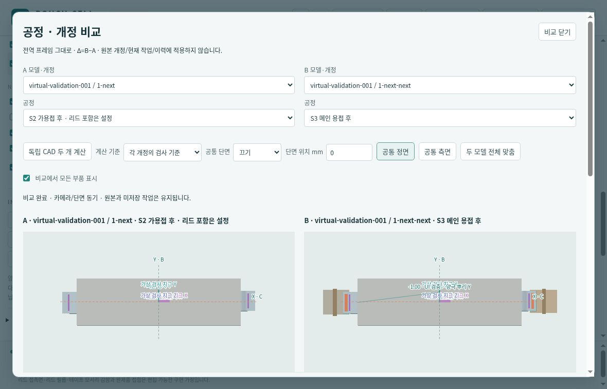

# v1.4 병합 후 실제 화면 검증

2026-11-18 KST. 사용자 요청으로 PR #5 병합 후 전체 개발 앱의 실제 UI를 확인했다. 기준 main은 `644f7235b4dd3cb82d26113432f3eb8b5f7703a8`이며 PR #5의 코드 트리와 동일하다. 검증 중 발견한 화면 문제는 `fix/integrated-ui-validation` 브랜치에서 수정하고 해당 경로를 다시 확인했다. 검증한 최종 코드 `56108e36bd16fc8b5351bfbbea5e9c4229e26d6f`는 [PR #6](https://github.com/playjae0/3D_cell_spec_simulator/pull/6)으로 main의 `b7940d9722741df02b1dc79de1a2ed5ce9706be1`에 병합됐다. 후속 스크린샷 추가는 실행 코드를 변경하지 않는다.

환경: Linux의 Cloud Chromium, 1180×757 화면, Node.js v24.22.1, Python 3.12 / CadQuery 2.7.0, `POUCH_PORT=8768 python cad/server.py`. 이 브라우저는 WebGL context 생성이 제한되어 기존 CPU CAD 렌더러로 실행했다. WebGL/사내 Windows/iPad 실기 결과로 확대 해석하지 않는다. 실행파일이나 배포 사이트는 변경하지 않았다.

## 실제 UI에서 완료한 경로

| 항목 | 조작과 관찰 결과 |
|---|---|
| 파일 가져오기 | `examples/intake/virtual-complete.json`을 `/workspace/shared/cell-ui-validation/virtual-complete.json`으로 복사해 실제 파일 선택기로 열었다. 검토표·µm 정규화·가상 출처 표시를 확인했다. S3 임시 CAD 생성 성공 후 적용해 `virtual-validation-001 / 1`로 등록했다. |
| 검사 세트 | S3 기본 검사 세트를 추가하면 100개, 다시 추가하면 0개였다. 기존 입력 검사 1개를 포함해 101개가 되었고, 사용자 검사 하나를 추가해 102개가 되었다. |
| 위치 규칙 | 양극 리드 상면에 U− 모서리에서 5 mm의 고정 기준점, U=20%/V=50%의 상대 기준점을 각각 만들었다. 서로 다른 anchor ID로 목록과 JSON에 보존됐다. |
| 부호 좌표 | `positive.tab.root`, legacy 프레임, Y 부호 좌표를 만들었다. 화면 계산값 −1.000 mm, 가이드의 원점/축/A 및 ‘B 사용하지 않음’을 확인했다. |
| 검사 보기 | 정면 카메라·단면 끄기·음극 리드 숨김·선택 검사를 프리셋에 저장했다. 측면/단면 Y=1/숨김 해제로 바꾼 뒤 적용하자 기존 보기로 복원됐다. |
| 개정 저장 | 검사 102개, 앵커 2개, 프리셋 1개를 `1-next` 개정에 저장했다. 다운로드한 보관함에도 모두 들어 있었다. |
| 백업 재가져오기 | 실제 보관함 내보내기로 받은 파일을 기존 목록에 다시 선택했다. 추가 0, 동일 개정 중복 2, 충돌 0 요약을 확인한 뒤 병합 적용했다. 기존 두 개정은 유지됐다. |
| 새로고침·재열기 | 브라우저 새로고침 후 보관함의 `1-next`를 열었다. 검사 102개가 복원되고, 프리셋 참조 확인 후 보기와 −1.000 mm 가이드가 복원됐다. |
| 실측 개정 보호 | 기준이 같은 개정에 가상 실측을 저장했다. 검사 원점 Y를 키보드로 0→10 mm 변경하자 계산값이 −11.000 mm가 됐다. 이 상태의 기존 개정 실측 추가는 ‘검사 기준 또는 형상이 저장 개정과 다릅니다…새 개정…’로 차단됐다. |
| S2/S3 비교 | 각각 독립 CAD가 생성됐다. 리드·본용접 영역·실런트에 ‘A 해당 공정에 없음 / B 존재’가 표시됐다. 없는 공정의 값을 0으로 표시하지 않았다. |
| 카메라·단면 동기 | 한쪽 창을 드래그해 양쪽이 함께 회전했다. 양쪽 SVG의 전역 축 투영 위치도 부동소수점 오차 범위에서 동일했다. 공통 측면과 Y=1 mm 단면을 확인했다. |
| 원본 보존 | 비교 종료 후 셀 JSON을 UI에서 내려받아 기존 저장본과 대조했다. product/stage/measurements/anchors/datumSet/inspectionDatums/inspectionViews 및 카메라·숨김·단면이 동일했다. 비교 실패 후에도 활성 작업을 유지했다. |
| 실런트 편집·개정 차이 | 양극 실런트 X 길이만 5→6 mm로 입력해 CAD 확정을 확인하고 `1-next-next`에 저장했다. 두 개정 비교에서 양극 길이 Δ=+1.000 mm, 음극 길이 Δ=0.000 mm였다. 음극 모든 부품의 CAD 외곽/체적 차이가 0이었다. |
| 숨김과 공정 | 숨겨 둔 실런트가 집중 보기와 복원에서도 숨김을 유지했다. S4에서 양극/음극 노란 테이프를 숨겨도 실런트는 각각 표시됐다. S3로 돌아오면 테이프가 없는 공정으로 복원됐다. |
| 취소 | 신규 모델 입력을 연 뒤 취소해도 현재 `1-next-next` 개정이 유지됐다. |

브라우저 도구의 파일 선택 권한 확인에서 긴 대기가 두 번 발생했다. 앱 자체의 로그인·설치 승인이 아니며, 실제 업로드와 재가져오기는 이후 성공했다. 대기 중 개발 서버 세션이 종료되어 한 번 `Failed to fetch`가 발생했고, 서버를 재시작한 뒤 같은 비교를 정상 완료했다. 테스트 데이터나 원본 개정을 지우지 않았다.

원점 편집의 첫 자동 fill 시도는 값만 입력되고 change가 확정되지 않아 계산값이 −1에 머물렀다. DOM 입력값만으로 성공을 판단하지 않고 실제 키 입력과 Tab으로 커밋한 후 −11 계산과 차단 메시지를 확인했다. 그 전후 가상 샘플은 테스트 기록으로만 남겼으며 실제 제품 데이터가 아니다.

## 화면 검증에서 발견해 수정한 사항

1. **비교 창 리드 잘림:** 본 화면의 확대율을 좁은 비교 창에 그대로 복원하던 문제가 있었다. 두 CAD의 전역 외곽 합집합을 두 화면 크기와 현재 시선에 투영해 공통 카메라를 맞춘다. ‘두 모델 전체 맞춤’을 추가하고 정면/측면 명령에도 적용했다. CAD 자체를 이동하거나 개별 정렬하지 않는다. 화면 높이도 현재 창 크기에 맞춰 조정했다.
2. **숨긴 부품과 공정 부재 혼동:** ‘비교에서 모든 부품 표시’를 기본으로 켜서 비교의 리드가 원본 숨김 때문에 누락되어 보이지 않게 했다. 끄면 각 원본의 숨김을 적용한다. 비교 종료 후 원본 숨김이 유지되는 것을 확인했다.
3. **불필요한 끝점 표기:** 부호 좌표 카드가 계산에 쓰지 않는 B 참조를 A→B처럼 표시하던 것을 ‘검사 원점 → A’로 수정했다. 반경은 단일 원호 참조로 표시한다. −1.000 mm와 올바른 원점 표기를 다시 확인했다.
4. **개정 저장 뒤 다른 개정처럼 보임:** 저장 완료 직후 다음 개정 입력창을 자동으로 열던 동작을 없앴다. 저장 완료 안내와 실제 저장된 개정 제목으로 돌아온다. `1-next-next` 저장으로 재확인했다.
5. **상태 설명:** 기준점 생성 성공 메시지와 검사 원점·축 안내를 보완했다. 보관함 병합을 읽을 때 이전 입력 검토 패널을 숨기도록 정리했다. 이 마지막 패널 숨김 변경은 파일 권한 대기를 반복하지 않기 위해 추가 업로드로 재검증하지 않았다. 병합 자체의 실제 왕복은 위 절차에서 확인했다.

## 검사 및 증빙

수정 후 `npm test`: **59/59 통과**, `npm run build`: 통과 (211 모듈). 신규 회귀 2개는 실제 Three.js 카메라로 서로 떨어진 두 CAD 외곽의 모든 꼭짓점이 좁은/넓은 창의 정면·측면·입체 화면 안에 들어오는지, 원본 외곽·카메라 불변과 잘못된 화면 크기 거부를 확인한다. 기존 57개도 함께 통과했다.

이번 수정은 화면/표기/저장 후 흐름에 한정한다. CAD 생성 및 STEP 코드는 변경하지 않아 이전 [28개 CAD 검사와 실제 API 결과](validation-integrated.md)를 유지하며, 이번에는 UI를 통한 실제 CAD 생성·공정 전환·치수 변경을 추가 확인했다. 새 CAD/STEP 전체 검사를 다시 실행한 것으로 기록하지 않는다.

아래 이미지는 위 검증에서 촬영한 가상 데이터 화면이다. 사용자 요청에 따라 저장소에 포함했다.

- [파일 검토·임시 CAD](validation-integrated/ui/01-intake-preview.jpg)
- [기존 목록 중복 병합](validation-integrated/ui/02-library-merge.jpg)
- [바뀐 검사 기준의 실측 차단](validation-integrated/ui/03-sample-guard.jpg)
- [수정 후 공통 정면](validation-integrated/ui/06-compare-front-fixed.jpg)
- [드래그 회전 동기](validation-integrated/ui/07-compare-rotation.jpg)
- [공통 Y 단면](validation-integrated/ui/08-compare-section-fixed.jpg)
- [5→6 mm, Δ=1 mm 개정 비교](validation-integrated/ui/09-revision-delta.jpg)

다운로드 파일의 실제 경로는 `/opt/codex/downloads/42fb5796-b4de-4879-91a1-42c6145a07e3/343459e3-2975-4ad6-9c04-f6175bfe3e41` (보관함)과 같은 디렉터리의 `ea0bef0f-7a66-441f-978b-85db2f448249` (비교 후 셀 JSON)이었다. 재가져오기는 보관함을 `/workspace/shared/cell-ui-validation/pouch-model-library.json`으로 복사해 수행했다. 이들은 개발 작업공간의 가상 테스트 산출물이며 지속적인 배포 URL이 아니다.

미검증: 실제 Windows/iPad, WebGL 경로, 실제 제품값/물성, 모든 저장 공간 오류의 브라우저 재현, 충돌 파일의 모든 UI 선택 조합. 충돌/매핑/손상 저장소/용량 실패/늦은 응답은 기존 자동 회귀 결과와 구분한다. 신규 파우치·실링바·실행파일 제작과 배포는 여전히 후속 범위다.
