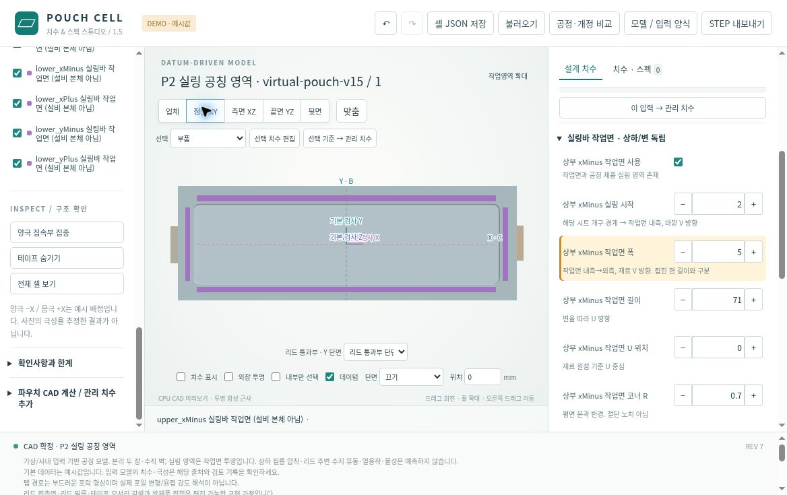
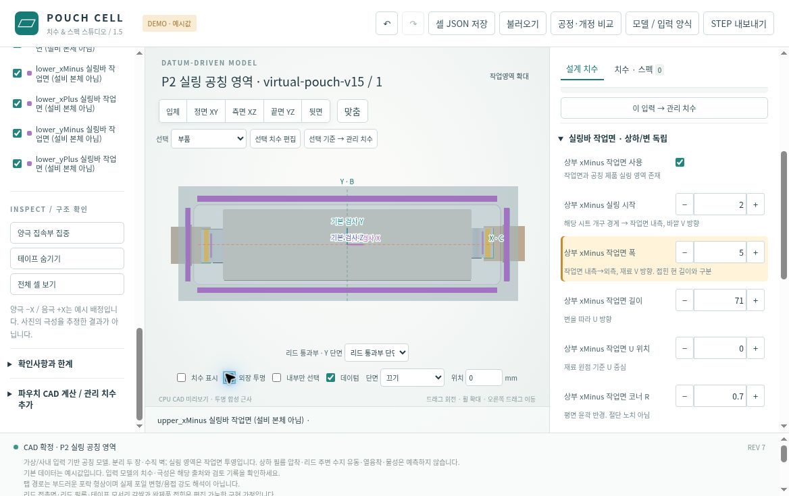

# v1.5 공정별 편집·표시 UI 검증

2026-11-18 (KST). 기준 main: `eaab1266d91de698acb93459897e7d73391c9b87` (PR #8 병합). 요청: [Cell_v15_UI_Handoff / 00_START](request-ui-v1.5.txt). 동봉 `stage-view-v15.patch`는 `git apply --check` 통과 후 적용했다. 기존 작업 폴더는 보존하고 별도 작업트리에서 수정했다.

## 변경 범위

- 현재 공정에 존재하는 부품별 편집 대상. 양·음극 테이프/실런트, 상하/각 변의 tool과 seal을 구분한다. 공통 실링 영역 등 계산 대상에는 독립 입력이 없음을 표시한다.
- 사라진 부품의 선택·강조·입력 연결을 갱신한다. 프리셋 복원 시 편집 대상과 선택 강조를 함께 맞추고 전체 셀 보기에서 이전 강조를 해제한다.
- 모델 치수 전체 표시 스위치는 개별 치수의 표시 상태를 수정하지 않는다. 데이텀·단면은 별개다. `view.showDimensions`는 생략 가능한 boolean이며 구버전은 표시 상태로 연다.
- 외장과 제품 실링은 반투명, 공구는 불투명으로 유지한다. WebGL 투명 재질은 depthWrite=false로 구성한다. 내부만 선택은 pouch/seal/tool을 제외한다. `view.internalOnly`를 JSON·프리셋에 보존한다.
- 부품이 없는 공정의 투명·내부 선택·테이프·집속 집중 컨트롤을 비활성화한다. 숨김 상태도 고려한다. 조건부 relief 및 테이프 입력은 유지한다.
- 입력 가이드에 안정 ID와 단위를 표시한다. [명칭 가이드](intake/internal-names-guide-v15.md), [CSV 266항목](intake/name-map-v15.csv)을 반영하고 README·Copilot 지침에서 연결한다. 내부 ID·단위·좌표 기준은 변경하지 않았다. 남아 있던 모달/저장 파일명의 v1.4 표기도 v1.5로 맞췄다.

형상 생성 엔진·CAD 지원 범위는 변경하지 않았다. [PR #8의 지원 범위와 가정](validation-pouch-v1.5.md)을 계속 적용한다. 이 작업은 리드 통과부의 국부 압착 구현이나 설치 프로그램 제작이 아니다.

## 실제 앱 조작

빌드된 앱과 로컬 CadQuery 2.7 서버를 실행하고 클라우드 Chrome에서 직접 조작했다. `examples/intake/virtual-pouch-1.2.json`을 **모델 / 입력 양식 → 가져오기 → S4 임시 CAD 생성 → 적용**으로 열었다. 모든 수치는 가상값이다. 아래는 자동 단위 테스트와 별개로 실제 UI에서 수행한 항목이다.

| 항목 | 실제 조작 및 결과 |
|---|---|
| S4 양·음극 테이프 | 각각 선택해 해당 테이프 입력만 표시됨. `positive.tapes.yellow.start=3.5 mm`, `negative.tapes.yellow.start=4 mm`. CSV의 극·부품·안정 ID·집속점 기준 바깥 X 방향을 화면 가이드 및 치수선과 대조. |
| S4 → S0 | 테이프 선택이 제거되고 편집 목록이 양·음극 포일/조립체로 변경. 테이프·외장 투명·내부 선택 컨트롤 비활성. 없는 테이프에 대한 강조가 남지 않음. |
| S3 실런트 | `positive.leadFilm`을 선택하면 실런트 5개 입력만 표시. 테이프 편집 대상은 없음. |
| P0 → P1 | P0에는 상하 포켓/외곽만 존재. 내부 선택 비활성. P1에서는 조립체 선택 및 치수/수납 위치 입력 가능. |
| P2 독립 작업면 | 상하 × 네 변 × tool/seal = **16개 대상을 각각 UI에서 선택**해 해당 `pouchProcess.toolFaces.<half_edge>.*` 입력만 표시됨을 확인. [실제 DOM 관찰 기록](validation-ui-v1.5/p2-editor-map.json). |
| P2 관리값 변경 | 상부 xMinus 폭을 **5→6 mm**로 수정·적용. 연결된 관리 치수가 5.000→6.000 mm로 갱신. 내보낸 실제 작업 JSON을 원본과 비교해 형상 입력 차이는 해당 필드 하나뿐임을 확인했다. [차이 기록](validation-ui-v1.5/edited-product-diff.json). 반대쪽 폭은 5.5 mm, 하부 xMinus는 5 mm 유지. |
| relief 조건 | upper_xMinus의 relief 비활성 시 관련 길이/폭/위치 입력 잠김. 자동 갱신을 끄고 relief를 체크하면 활성, 입력 취소 시 다시 잠김. 이 확인은 입력 조건의 검증이며 새 relief CAD 검증을 의미하지 않는다. |
| 리드 단면 | 양·음극 중심/폭 끝/바깥 8개 선택지가 유지됨. 양극 중심 Y=-0.5를 실제 선택하여 Y 법선 단면과 위치가 갱신됨. |
| 치수 전체 표시 | 단면·데이텀 ON. 상부 xMinus 폭과 조립체 길이만 표시하고 조립체 폭/두께 등은 숨김. 전체 표시 OFF 시 치수선·값이 사라지고 데이텀·단면 유지. ON 시 두 치수만 복원. 개별 체크 조합은 전후 동일. |
| 투명 전후 | 같은 정면 카메라·배율·부품 표시 상태에서 불투명/투명 화면을 저장. 외장 내부의 조립체와 탭/테이프가 드러나며 보라색 공구는 불투명 유지. |
| 내부 선택 | 같은 정면의 upper_xMinus 공구 위치 클릭 시 일반 모드는 tool, 내부만 선택 모드는 양극 리드 실런트 선택. 공구를 숨긴 일반 모드에서는 같은 위치의 제품 seal 선택. 공구와 제품 실링이 별개임을 확인. |
| P3/P4 및 호환 | P3 절단, P4 순차 폴딩, 기존 packaged, finished로 실제 전환해 CAD 확정 및 해당 부품 편집 목록 확인. P4는 배율을 줄여 전체 형상을 기록. |
| 검사 보기 | 단면 Y=-0.5, 투명, 내부 선택, 개별 치수 조합을 프리셋으로 저장. 설정과 카메라를 바꾼 뒤 적용해 복원. |
| 개정 재열기 | 검사 235개·프리셋 1개가 있는 작업을 `1-next`로 저장. 기존 `1`을 열면 원래 S4·검사 0개로 유지. `1-next`를 다시 열면 P2·235개·프리셋·단면·표시 상태 복원. |
| JSON 재열기 | P4 작업을 셀 JSON으로 내보냄. 최종 빌드로 새로고침 후 해당 JSON을 다시 열어 P4 CAD 확정, 검사 235개, 프리셋 1개, 전체 치수 OFF 복원 확인. |

## 화면 증거

동일 정면, 불투명:

동일 정면, 외장/제품 실링 반투명·공구 불투명:

다른 조작 기록: [S4 양극 테이프](validation-ui-v1.5/01-s4-positive-tape.jpg), [S0 선택 갱신](validation-ui-v1.5/02-s0-cleared.jpg), [P0 외장만](validation-ui-v1.5/03-p0-shell-only.jpg), [단면·치수 ON](validation-ui-v1.5/06-section-dimensions-on.jpg), [단면·치수 OFF](validation-ui-v1.5/07-section-dimensions-off.jpg), [P4 폴딩](validation-ui-v1.5/08-p4-folded.jpg).

최종 빌드에서 다른 부품을 선택한 뒤 프리셋을 다시 적용해 선택 부품·편집 대상도 조립체로 함께 복원되는 것을 확인했다. [최종 UI](validation-ui-v1.5/09-final-ui.jpg).

## 자동 검증과 실행

- `npm test`: **71/71 통과**. [로그](validation-ui-v1.5/js-tests.txt). 추가한 6개 회귀 검증은 공정/극별 편집 연결, 16개 tool/seal 연결, 실제 Three Raycaster 내부 선택, 실제 Three 재질 설정, 치수 SVG/선택 대상 숨김, JSON·프리셋·구버전 호환을 확인한다.
- `npm run build`: 성공. [로그](validation-ui-v1.5/build.txt). 기존 단일 JS 번들의 500 kB 경고는 남아 있다.
- CSV 266개 행의 parameterId·명칭·partId·기준·단위를 `dictionaryFor(template().componentInstances)`와 대조: 누락·추가·불일치 없음. 사내 명칭/근거/확인상태 열은 아직 빈칸이다.
- CAD 소스 변경 없음. 이번 로컬 작업에서는 전체 CAD 회귀를 반복하지 않고 위 공정들을 실제 앱에서 재생성했다. STEP 재출력/재가져오기는 이번 회차에 수행하지 않았다.

실행 요건은 [README](../README.md)의 Node.js 22.12+, Python 3.12 64-bit, CadQuery 2.7과 Chrome/Edge로 동일하다. 의존성 설치 후 `npm run build`, `python cad/server.py`를 실행하고 `http://127.0.0.1:8765`를 연다. 이번 검증은 기존 서버와 충돌하지 않도록 `POUCH_PORT=8770`을 사용했다. Docker·외부 API·CDN은 실행에 필요하지 않다.

## 미확인과 제한

- 이 환경의 WebGL 컨텍스트가 생성되지 않아 **실제 화면은 CPU CAD 미리보기**로 검증했다. 투명 합성은 근사이다. WebGL 재질의 opacity/depthWrite와 선택 로직은 자동 검증했으나, 실제 GPU 화면은 확인하지 않았다.
- 사내 Windows/Edge, 실제 제품 치수·도면, 현장 명칭의 확정 대응, 오프라인 배포물·EXE는 이번 검증 대상이 아니다.
- PR #8의 형상 지원 제한(국부 리드 압착, 미지원 컵/접힘 방식 등)은 그대로다. 투명 표시 개선을 새로운 CAD 물리 형상의 구현으로 해석하지 않는다.
