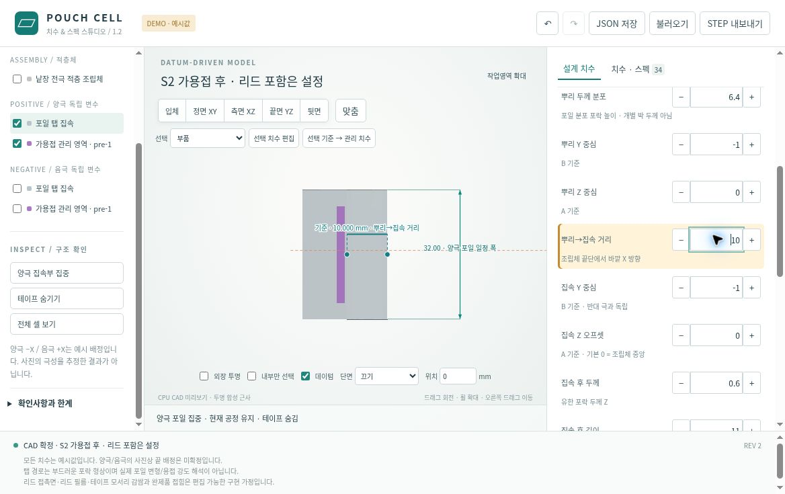
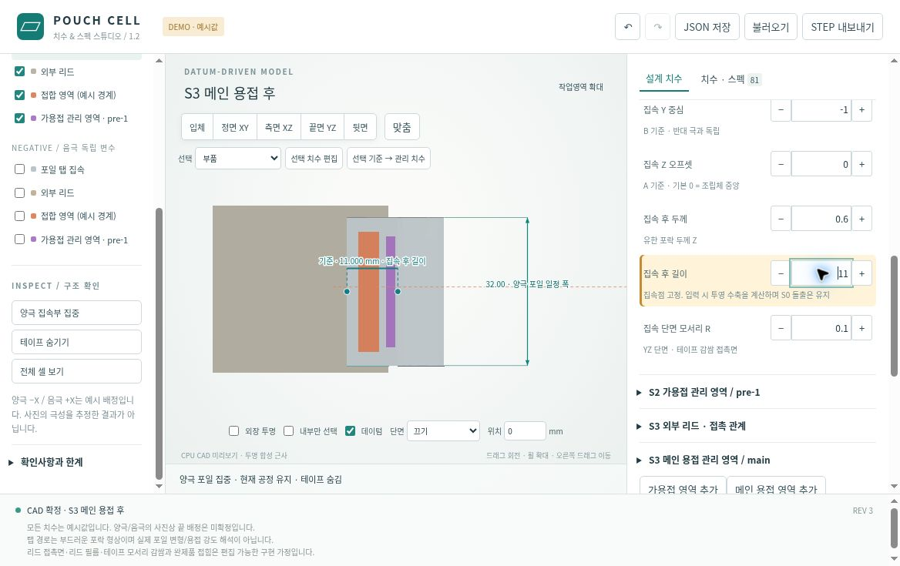
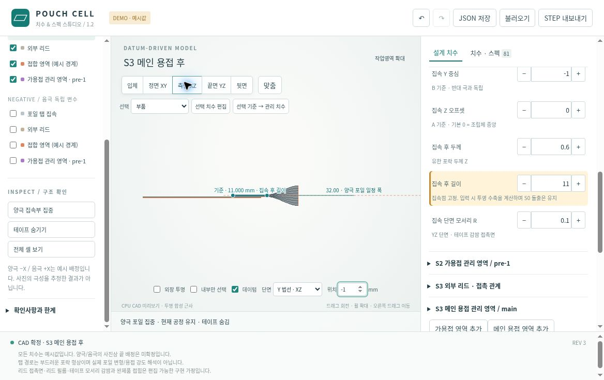
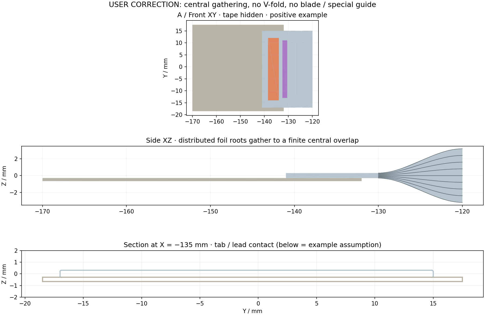
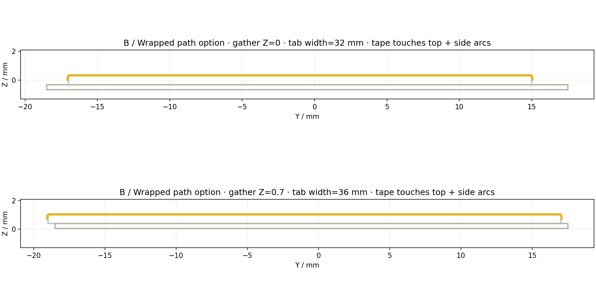
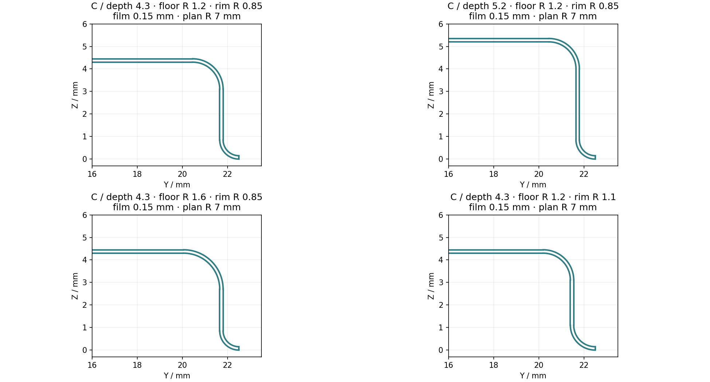

# v1.2 검증 기록

2026-11-17. 모든 값은 가상 예시. 기준 main `2d7b606`의 CAD를 확장했다. 제품 치수 정확도, 물리 변형, 사내 설치 적합성을 인증하는 결과가 아니다.

## 실행 결과

|확인|결과와 증거|
|---|---|
|JavaScript|24개 통과: 거리/투영/두께/R, 대량 JSON, 명시적 폭 변환, 필드 연결, 최신 요청 우선, 취소/실패 처리. [로그](validation-v1.2/js-tests.txt)|
|CadQuery|22개 통과: 기존 12 + 공정/폭/전달 방향/관리 영역 표시 좌표 10. [로그](validation-v1.2/cad-tests.txt)|
|실제 HTTP API|7개 공정 생성, token/revision 검증, 양극 폭 변경 시 실제 CAD 체적 변화·음극 유지, 불가능한 값 422 응답. [로그](validation-v1.2/api-tests.txt)|
|화면 빌드|성공. Three.js를 포함한 JS 약 571 kB이며 Vite의 500 kB 크기 경고가 남는다. [로그](validation-v1.2/build.txt)|
|STEP 왕복|7개 공정 모두 mm, 솔리드 유효성·개수·외곽·체적 확인. [S0–S3](validation-v1.2/early-step-roundtrip.json), [S4–S6](validation-v1.2/step-roundtrip.json)|

STEP 재가져오기는 동일 CadQuery/OpenCascade 커널로 수행했다. 최대 외곽 차이 약 0.0000002 mm는 이 예제의 수치 왕복 결과이며 제품 정밀도가 아니다. 가용접/접합 관리 면은 재료 솔리드가 아니므로 STEP 재료에서 제외한다. 관리 스펙은 JSON을 함께 보관한다.

## 브라우저에서 실제 조작한 시나리오

Linux Chrome + 로컬 `/api/rebuild` + CPU CAD 표시 경로에서 확인했다. API가 고정 메시를 돌려주는 프리뷰가 아님을 확인했다.

1. 양극 폭 32 → 34 → 직접 편집창 35 mm. 뿌리 폭에 대응하는 독립 입력을 편집했다. CAD 단면 시험에서는 Y 편심을 둔 35 mm 탭을 뿌리·전이 중간·집속 구간 6곳에서 잘라 일정 폭을 확인했다. 음극 입력과 CAD는 독립이다.
2. 입력 포커스 시 시작/끝 점과 고정 기준 가이드가 표시된다. 등록 모서리/표시 치수선 더블클릭으로 편집창이 열린다. 39를 입력한 뒤 Esc로 닫으면 기존 32가 유지된다.
3. 계산 겹침 길이 9 mm의 원인 입력에서 리드 시작을 2 → 3 mm로 수정하면 실제 CAD와 계산 표시가 8 mm로 갱신된다. 계산값 자체를 덮어쓰지 않는다.
4. 같은 폭 필드의 `+` 3회가 32 → 32.3이 되고, undo 한 번으로 32로 돌아간다. redo 직후 S0 → S1 전환해도 최신 32.3을 유지한다. 지연/역순 응답은 별도의 큐 단위시험으로 확인했다.
5. 폭 200 mm는 뿌리가 조립체 폭을 벗어난다는 원인을 표시하고 이전 정상 CAD를 유지한다. 미적용 상태에서 JSON 저장이 잠긴다. 수동 모드에서 33 입력 → 입력 되돌리기 → 32, 다시 33 입력 → 수동 CAD 적용을 확인했다.
6. S2 기본 리드 없음 → 양극만 리드 포함 설정. 음극에는 리드가 생기지 않는다. S3 리드 시작 3과 S2 별도 시작 2가 유지된다. S3에는 테이프가 없고 S4에는 테이프가 있다.
7. 가용접과 메인 용접 색상 관리 영역이 해당 극의 탭 위치에 표시된다. 표시용 면도 조립체 배치 변환을 적용하도록 수정했다. 실제 접합면 기준과 상면 투영 표시를 분리한다.
8. v1.1 JSON에서 양극 뿌리 38/집속 32, 음극 뿌리 36/집속 29의 차이를 확인하고 양극 32·음극 36을 명시적으로 선택했다. 원본 product와 선택 내역이 저장 JSON에 남는다.
9. 폭 입력을 관리 치수로 추가하고 목표 32, 공차 ±0.5, 실측 32.2와 설명을 저장했다. 설계 폭은 32를 유지한다. 이후 설계 폭을 33으로 바꿨다가 저장 파일을 열면 32와 실측 32.2가 복원된다. [브라우저 저장 결과](validation-v1.2/ui-roundtrip.json)에 stable featureId와 migration 원본을 보존했다.

## 화면과 CAD 단면

가용접 정면. 보라색은 실제 비드가 아닌 가용접 관리 영역이다.

메인 용접 정면. 주황색 접합 관리 영역과 보라색 가용접 기준을 구분하고 테이프는 없다.

실제 CAD에서 투영/절단한 상세 정면·측면·단면. 분포선은 설명용이며 실제 포일 장수가 아니다.

## 남은 범위

Windows/iPad 실제 장치, GPU WebGL 경로, 조직의 실제 오프라인 설치 정책은 별도 인수 검증 대상이다. 실행 중 CDN/API는 필요 없지만 최초 패키지 설치 또는 대상 OS용 의존성 반입이 필요하다. 이번 검증은 로컬 주소를 사용했으며 운영체제 전체 네트워크를 차단한 시험은 아니다.

등록된 의미 기준과 모서리만 직접 편집한다. 임의 CAD 토폴로지의 모든 모서리·면에서 독립 변수를 자동 추론하지 않는다. 개별 포일 물리 변형, 용접 압흔/용입, 실링바 윤곽, 고객 STEP 가져오기, PMI 및 자동 2D 도면은 구현 완료로 표시하지 않는다. 각도/전개길이 관리 치수는 별도 확장 대상이다. SKOn 실링바 추가 ZIP은 이번 파일 목록에서 확인되지 않아 기존 파우치/실링 구현을 유지했다.

## 변경 파일과 다음 수정 위치

- `cad/process.py`: 상태별 입력 해석/전달 방향. `cad/model.py`: 일정 폭 포일·가용접·등록 기준·표시 영역 좌표. 기존 `cad/proof_pocket.py`는 변경하지 않았다.
- `src/data/bindings.js`: 필드–부품–기준–원인 입력 연결. `fields.js`: 입력 정의. `project.js`: 공정 템플릿/스키마. `migration.js`: 원본 보존 변환.
- `src/geometry/queue.js`, `client.js`: 실제 CAD 연결, 자동 갱신, 최신 요청 우선. `cad/server.py`: 상태/요청 식별을 반환하는 로컬 API.
- `src/main.js`, `src/viewer/viewer.js`, `index.html`, `src/style.css`: 양방향 선택/직접 편집/수동 적용/이력/저장. 일부 기존 JS는 읽기 쉽게 포맷만 정리했다.
- `tests/process.test.js`, `tests/process_geometry.py`, `scripts/check_process_step.py`: 새 회귀 검증. 나머지 기존 시험은 새 schema와 단일 폭 기준에 맞춰 유지했다.

새 부품/입력을 추가할 때 [필드 연결표](field-geometry-map-v1.2.md), [공정·데이터 명세](spec-v1.2.md), [Copilot 지침](../.github/copilot-instructions.md)을 함께 갱신한다.
