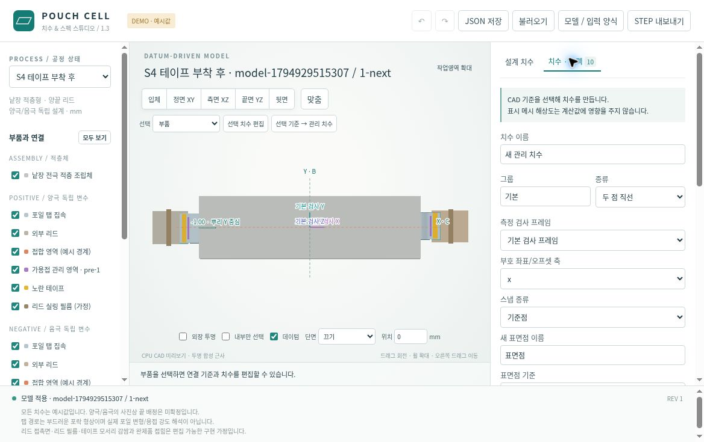
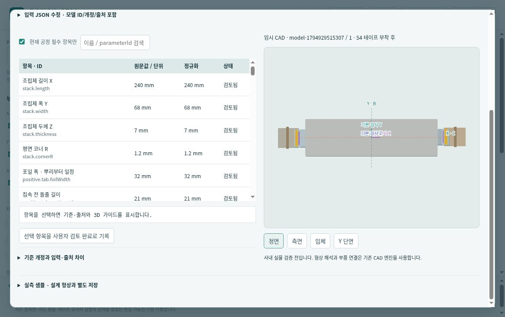
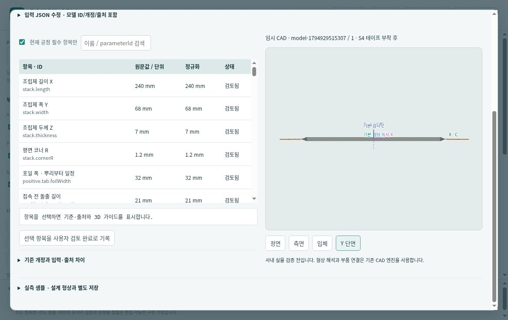
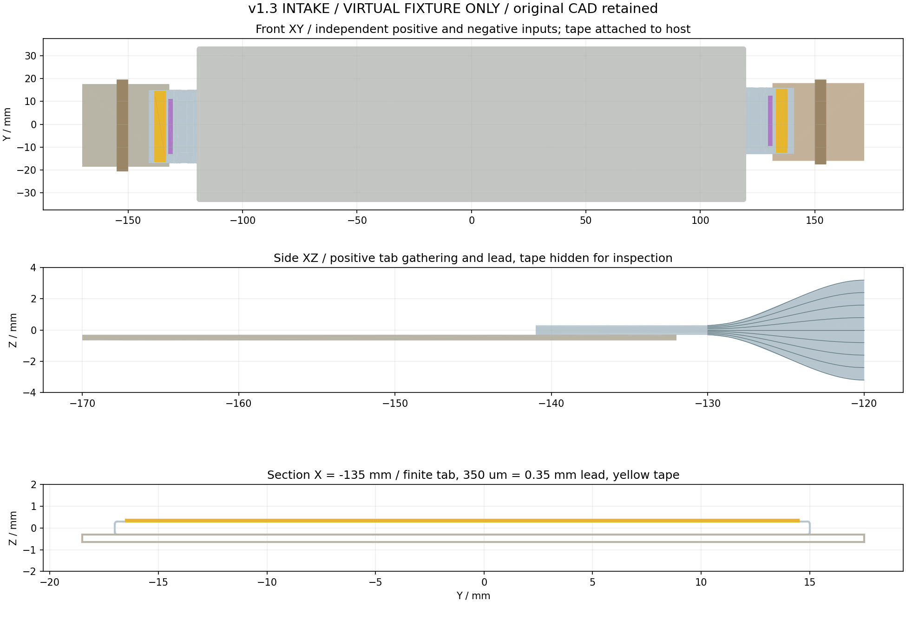

# v1.3 검증 기록

검증일: 2026-11-18 한국시간 / 2026-11-17 UTC. 기준 코드는 main `3e0f9f8a3d63601a6f310d6a383f714650dfeff4`(PR #3 병합)이다. 사용자 확인에 따라 Claude에서 연 전체 프로그램을 기준으로 변경했다. 별도 정적 리뷰 사이트는 수정하지 않았다. 모든 검증 데이터는 가상값이다.

## 코드와 실제 CAD 검사

| 실행 | 결과 | 확인 범위 |
|---|---|---|
| `npm test` | 42/42 통과 | 기존 회귀 + intake 18개: 출처·단위·누락·충돌·공정 필수 조건, stable ID 재정렬, 불변 개정/별도 샘플, 취소/지연 응답, 수동 변경 이력, 부호 치수, 고정 mm 앵커, 기존 JSON 호환 |
| `python -m unittest discover -s tests -p '*geometry.py' -v` | 25/25 통과 | 기존 CAD 22개 + intake 3개. 미래 공정 값이 null인 각 공정의 실제 CAD 생성, 불가능한 뿌리 폭 거부, 기존 비대칭·테이프·포켓 및 STEP 재가져오기 회귀 |
| `python scripts/check_api.py http://127.0.0.1:8767` | 통과 | 실제 HTTP 서버의 기존 7개 공정, 독립 극 편집, 잘못된 형상 거부 |
| `node scripts/check_intake_api.mjs http://127.0.0.1:8767` | 통과 | schema4의 희소 S0 입력, 350 µm→0.35 mm, 양극 집속 Y 변경 시 음극 CAD 보존, 요청 토큰 |
| `npm run build` | 통과 | 로컬 번들 생성. 실행 시 외부 CDN/API 불필요 |
| `git diff --check` | 통과 | 패치 공백 오류 없음 |

검사는 Linux/Python 3.12/CadQuery 2.7/Node 환경에서 수행했다. GitHub Actions 워크플로도 추가했으며, 원격 실행 결과는 PR의 Checks를 기준으로 확인한다.

## 브라우저에서 직접 확인한 경로

로컬 전체 앱 `http://127.0.0.1:8767/`을 Cloud Chrome에서 조작했다. WebGL을 사용할 수 없는 이 환경에서는 기존 CPU CAD 미리보기를 사용했다.

1. 모델/입력 양식 → 현재 모델 새 개정 → 검토표 → S0 임시 CAD. 원문 단위·출처·기준·필수 상태를 확인했다.
2. 취소 후 기존 공정과 undo 비활성 상태가 유지됨을 확인했다.
3. 현재 모델 복사 → S4 테이프 상태 → 임시 CAD 정면/측면/단면 → 적용. 새 modelId/개정이 표시되고 undo가 활성화됐다.
4. 양극 뿌리 Y=-1 입력에서 관리 치수 생성 → **−1.000 mm** 표시를 확인했다. 기존 절댓값 거리 모드는 유지한다.
5. 현재 작업을 새 개정 `1-next`로 저장하고, 같은 검사 항목에 별도 가상 샘플 A/C를 기록했다. 샘플 입력 후 항목 선택이 초기화되는 문제를 수정하고 다시 확인했다.
6. 페이지를 새로 연 후 모델 목록에서 저장 개정을 열어 실제 CAD, 검사 항목, −1.000 mm 치수를 복원했다. 검사 프레임 추가 UI와 표시 선택도 확인했다.

## 형상 증거

아래 이미지는 `scripts/render_intake_proof.py`가 가상 intake를 실제 adapter와 CadQuery BRep으로 생성한 정면·측면·단면이다. UI 캡처와 별도로 생성한 기술 확인 그림이며 사진 실측이나 실제 포일 변형 해석 결과가 아니다. 기존 중심 집속, 유한 겹침, 테이프 부착 경로를 유지했다.

## 완료·제한·미확인

- 구현: 정식 intake 1.0 양식/사전/스키마, 공정별 필수 조건, null/근거/충돌 보존, 별도 임시 CAD와 적용/취소, 모델·불변 개정·실측 샘플 분리, 개정 비교, 부호 치수, datumId, 상대/고정 mm 표면점, 사내 Copilot 지침.
- 파일 선택 대화상자를 통한 JSON 업로드는 자동화 호출이 시간 초과되고 사용자가 권한 거부를 알려와 재시도하지 않았다. 파일 선택부터 적용까지의 UI 전 과정을 검증 완료로 주장하지 않는다. JSON 파싱·검증·변환·실제 CAD API 경로는 자동 검사했고, 검토/미리보기/적용 UI는 기존 모델 복사로 확인했다.
- Windows 사내 PC, 오프라인 설치/실행, iPad 실기, 실제 사내 치수/도면의 정확성은 미확인이다. Docker는 필요 없지만 Python/CadQuery와 최초 의존성 설치는 필요하다.
- 브라우저 localStorage는 협업 DB가 아니다. 보관함 병합/인증/자동 백업은 미지원이며 JSON 백업이 필요하다. 미완성 draft와 적용 가능한 모델은 구분한다.
- 신규 다중 영역은 JSON 검토/양식에서 instanceId로 정의한다. 전용 영역 생성 마법사는 없다. 검사 프레임은 원점 XYZ와 Z 회전, 표면점은 등록된 평탄 패치만 지원한다.
- 실링바 CAD, STEP UI 가져오기/PMI, 도면 자동 생성, 실제 포일 변형·용접 강도 해석은 이번 범위에 없다. 기존 CAD의 실제 형상·제조 해석 제한은 [기준 명세](spec-v1.2.md)를 함께 적용한다.

실행과 인계: [README](../README.md), [v1.3 명세](spec-v1.3.md), [사내 Copilot 작성 지침](intake/internal-copilot-prompt.md).
