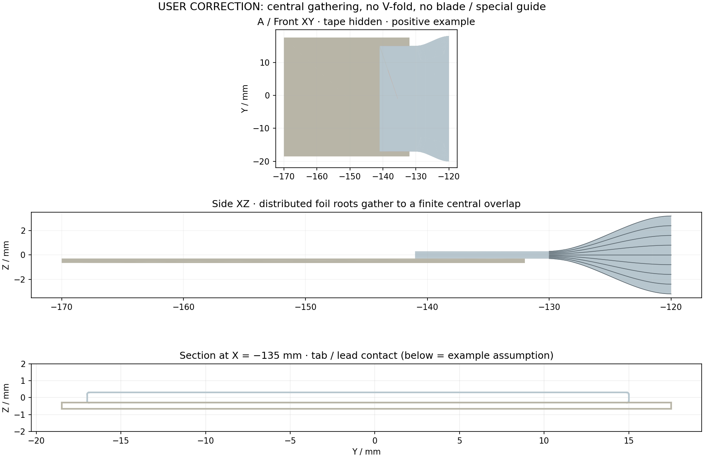
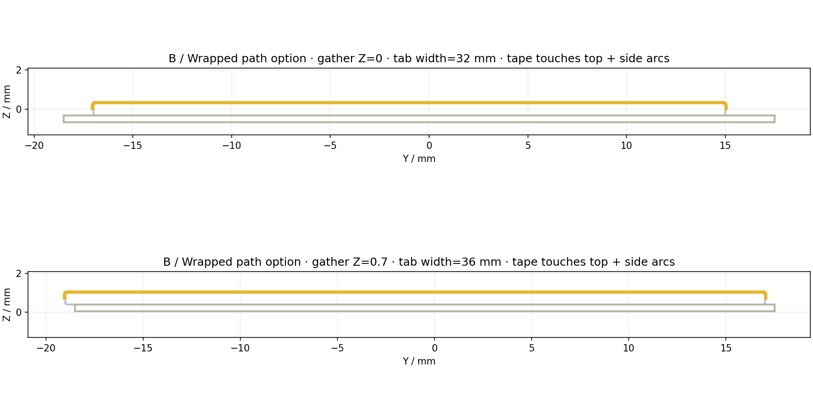
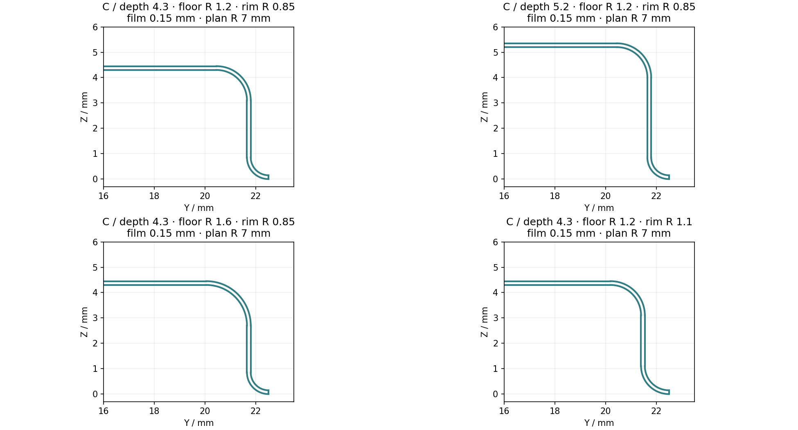
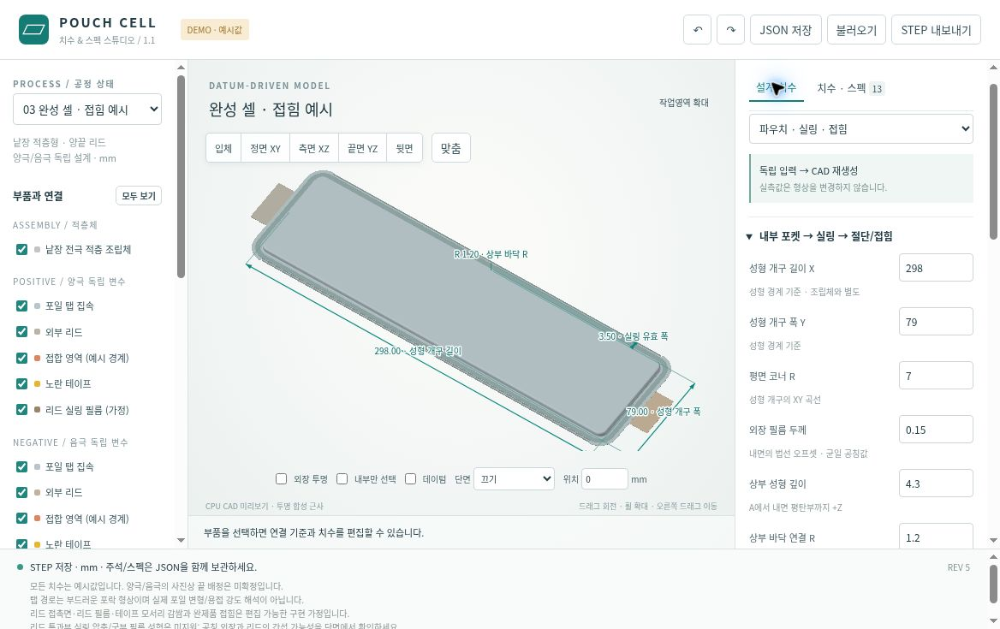

# v1.1 실행·검증 기록

2026-11-17, Linux x86_64 / Python 3.12 / CadQuery 2.7.0 / OCP 7.8.1.1.post1 / Node 24 / Chrome. 모든 치수는 가상 예시다. 아래 결과는 소프트웨어와 CAD 모델의 일관성 검증이며 실제 제품 치수의 정확도나 제조 공정 검증을 의미하지 않는다.

## 자동 검증

- JavaScript 12개: 직선/검사 축 투영, 대응 면 두께, 반경과 치수선, 무효 참조, 10,000개 치수 JSON 왕복, 잘못된 데이터, 실측 분리, 이력, 단면 클리핑, 평면 자유점 추종/제거. [실행 로그](validation/js-tests.txt)
- Python CAD 12개: 비대칭 독립 수정, 테이프 부착 유지, 상·하 부착면/리드 접촉 관계, 포켓 깊이와 R 독립 변경, 상태별 부품 ID, 실링/여유 구분, 오류 거부, 삭제 참조, 기준점의 실제 CAD 면 위치, 메시 해상도와 계산 분리, 3개 상태 STEP 왕복. [실행 로그](validation/cad-tests.txt)
- production 빌드 성공. Three.js 포함 번들 크기에 대한 Vite 경고는 남아 있다. [빌드 로그](validation/build.txt)
- 로컬 production HTML → CAD API → 3개 상태 생성, revision 응답, 잘못된 폭의 HTTP 422 거부 확인. [API 기록](validation/api-tests.txt)

STEP 재가져오기: 내부 조립체 9, 패키징 19, 완성 23개 솔리드. 유효 BRep, mm 단위, 솔리드 수, 체적, 외곽 치수 일치 확인. 최대 외곽 치수 차이 **2.00000018×10⁻⁷ mm**. 이는 동일 CAD 모델의 파일 왕복 수치 차이다. [상세 수치](validation/step-roundtrip.json)

화면에서 실제로 다운로드한 완성 STEP도 별도로 열어 유효함, 23개 솔리드, 외곽 341.5 × 93.4 × 8.8 mm를 확인했다. 파트 개수와 솔리드 개수는 다를 수 있다. 접합 관리 면은 STEP 재료 솔리드에서 제외하고, 접힘 여유는 여러 솔리드의 compound다.

## 브라우저 조작 확인

- 기존 v0.4를 실행해 대칭 박스 형상과 연결 기준의 한계를 확인했다. 기존 형상 생성기는 재사용하지 않았다.
- 양극 리드 폭 36 → 40 mm 변경, 음극 34 mm 유지, 표시 치수 40 mm 갱신.
- 조립체 폭 5 mm의 불가능한 입력 거부, 이유 표시, 마지막 정상 68 mm 형상 유지.
- 모델 평탄면에서 이름이 있는 자유점 2개 선택. 거리 124.678 mm, 폭 68 → 70 mm 변경 시 124.821 mm로 갱신. JSON 재열기 후 68 mm와 124.678 mm 복원.
- 목표 125, 하한/상한 공차 각각 1, 실측 124.9, 측정 조건 메모를 입력하고 공차 내 표시 및 JSON 보존 확인. [검토용 예시 파일](../examples/review-with-specs.json)
- 부품 숨김, 테이프 숨김, 외장 투명/내부 선택, 3개 공정 상태, 정면/측면/단면, 치수 표시, JSON 다운로드/재열기, STEP 다운로드 확인.

이 환경은 WebGL 컨텍스트를 제공하지 않아 CAD 메시의 CPU z-buffer 표시 경로를 실제 검증했다. 일반 GPU WebGL 경로, Windows PC, iPad 터치, 사내망 오프라인 설치는 아직 실기 검증하지 않았다. 번들에는 외부 CDN/폰트/API 요청이 없으며 서버는 127.0.0.1에만 바인딩한다. 물리적 네트워크 차단 시험을 수행했다고 주장하지 않는다.

## 핵심 형상 A–C

### A. 테이프를 숨긴 중심 집속부

정면 XY, 측면 XZ, 집속 구간의 YZ 단면. 부드러운 경로와 유한한 집속 폭/두께/길이, 별도 리드 및 접합 관리 영역을 확인했다. 포일 선은 분포를 설명하는 표시이며 개별 포일의 물리 변형 예측이 아니다. 사진의 여러 제품은 하나로 합치지 않았다. 특허 S1의 V자/블레이드, W2 가이드, W3 복합 용접 구조를 사용하지 않았다.

### B. 부착 면을 따라가는 테이프

탭 폭과 집속 Z를 바꾼 전후의 CAD 단면. 테이프–탭 최소 거리 0, 체적 겹침 없음. 기본 노란 테이프는 사진에서 보이는 상면 띠이며 모서리 감싸기는 별도 경로 옵션이다. 보이지 않는 뒷면 경로를 확정하지 않는다.

### C. 깊이·바닥 R·상단 R을 분리한 포켓

4개 설정의 정확한 CAD 단면 비교. 필름 내면/외면과 두께, 서로 다른 두 연결 원호를 확인했다. 필름 두께는 내면의 법선 오프셋이다. 성형에 따른 실제 국부 박육은 계산하지 않는다.

## 전체 화면

[완성 셀 정면](validation/pouch-finished-front.jpg) · [측면](validation/pouch-finished-side.jpg) · [단면](validation/pouch-finished-section.jpg) · [패키징 상태](validation/pouch-packaged-final.jpg)

## 남은 제한

리드 통과부의 파우치 국부 성형과 실링 압축을 아직 모델링하지 않았다. 따라서 현재 외장과 리드의 국부 간섭은 실제 제품 적합성으로 판정할 수 없다. 완성 상태 접힘은 길이 보존 원호와 코너 릴리프를 사용한 예시다. 실제 접힘 순서/주름은 미확정이다.

임의 CAD 면·모서리 전체의 자유 스냅은 지원하지 않는다. 등록된 의미 기준과 리드/조립체 평탄면 자유점을 지원한다. 두께는 같은 부품의 대응 Z 면, 반경은 등록된 원호 기준에 한정한다. 끊어진 참조는 오류로 표시하며 사용자가 재연결한다. 데이터 20,000개 제한, 표시 200개 제한이며 10,000개 검증은 저장 왕복이다.

고객 STEP 가져오기/파라미터 역추론, STEP PMI, 도면 자동 생성, 모든 임의 모따기, 임의 곡면 테이프, 물리 해석, 실제 사내 치수 검증은 미지원이다. [구현 명세](spec-v1.1.md), [출처 적용/제외](evidence-decisions.md), [실행·오프라인 인계](offline-handoff.md)를 함께 확인한다.
