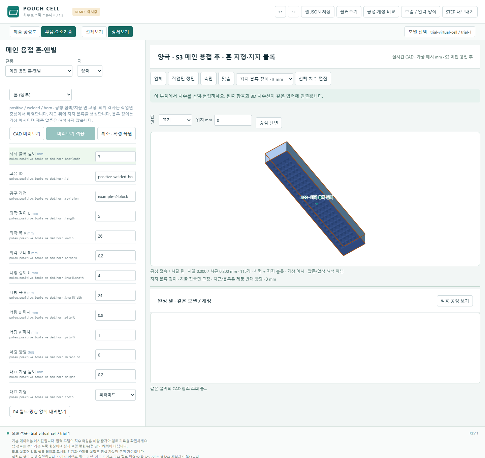
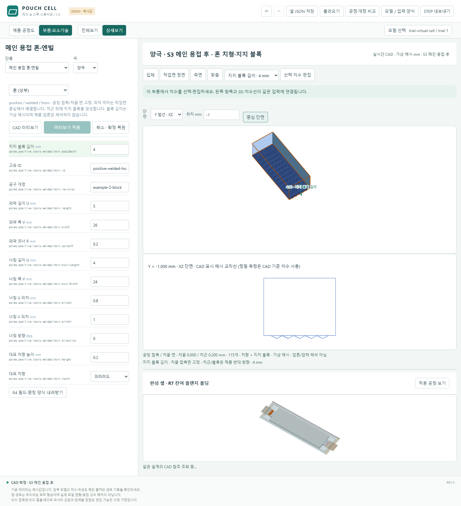

# Windows 시험판 검증 · 2026-11-19

미반영: 요청한 실행 ZIP·동일 버전 입력키트·수동 빌드는 모두 생성했다. 공개 Release·설치 관리자·코드 서명·자동 업데이트·PDF/이미지 입력은 이번 범위 밖이다.

부분 검증: 별도 Windows 러너에서 앱·동봉 Python·Edge의 외부 통신을 방화벽으로 차단해 시험했다. Actions 제어 통신은 유지했으므로 PC 전체 네트워크 단절 시험은 아니다.

미검증: 개발 도구가 전혀 없는 Windows 10/11 이미지와 실제 사내 정책 적용 PC에는 접근하지 못했다. 따라서 해당 환경의 실행 승인·보안 정책·브라우저 호환성은 현업의 마지막 시험이 필요하다. 아래 러너 결과를 깨끗한 사내 PC 검증으로 간주하지 않는다.

## 버전과 다운로드

- 요소기술 병합 기준선: `e3af45a02045111c79ec38d3172785ce7631a277` (PR #11).
- 실행판·입력키트의 실제 소스: **`b2f8a3694e19399dfe08708169a3cae68c2f6125`**.
- 구현은 [PR #12](https://github.com/playjae0/3D_cell_spec_simulator/pull/12)로 main `3c9b6fa9656057333b55bd4662a2f19bb3dbcd6a`에 병합되어 있다. 추가 검증 보고서는 별도 문서 PR이다.
- 작업 브랜치: `feat/windows-trial`. 이 보고서는 위 실행판 생성 후 추가한 문서이며 실행판 소스를 바꾸지 않는다.
- [수동 Windows 빌드 및 별도 실행 검증 — 성공](https://github.com/playjae0/3D_cell_spec_simulator/actions/runs/44490018962).
- [실행 ZIP 다운로드](https://github.com/playjae0/3D_cell_spec_simulator/actions/runs/44490018962/artifacts/14512566774).
- [입력키트 ZIP 다운로드](https://github.com/playjae0/3D_cell_spec_simulator/actions/runs/44490018962/artifacts/14512835453).
- [전체 실행 증거 다운로드](https://github.com/playjae0/3D_cell_spec_simulator/actions/runs/44490018962/artifacts/14511809667).

Actions 다운로드는 바깥 ZIP 안에 아래 배포 ZIP이 들어 있다. 안쪽 ZIP도 전체 압축 해제한다. 산출물은 30일 보관(2026-12-19 만료 예정)되므로 승인된 공유 경로에 동일 ZIP을 보관할 수 있다. 공개 Release는 만들지 않았다.

| 산출물 | ZIP bytes | 압축 해제 bytes |
|---|---:|---:|
| CellStudio-win-x64-b2f8a3694e19.zip | 221,043,132 | 762,041,968 |
| CellStudio-IntakeKit-b2f8a3694e19.zip | 80,456 | 1,739,562 |

실행판 7,340개 파일. ZIP CRC 및 배포 허용 목록 검사 통과. 실행 ZIP SHA-256: `86114b529ca0b12d45690ae674cedd185a4eed0f9d7a850ad769aebe5a7a4c46`.

큰 구성은 CasADi 약 200.06 MB(수치 계산 의존성), OCP와 네이티브 라이브러리 약 194.91 MB(정확 CAD/STEP), VTK 약 185.19 MB(메시·시각화 의존성), NumPy 약 42.74 MB다. CAD 정확도나 필요한 라이브러리를 줄이지 않았다. 조사 문서·인계 ZIP·개발 캡처·캐시·중복 프리뷰 메시·사용자 셀 데이터는 포장하지 않았다. [실제 크기](evidence/size-report.json), [CRC·허용 목록·구성 감사](evidence/package-audit.json).

## 환경별 확인 결과

| 환경 | 실행과 결과 | 판정 범위 |
|---|---|---|
| Linux 개발 환경 | JS 89/89, CAD geometry 63/63, 일반 웹 빌드 성공. 실시간 가져오기·편집·CSV·저장·새 브라우저 프로필 복원 통과 | 개발 환경 회귀 |
| Windows Server 2022 빌드 러너 | Node 22, CPython 3.12.10, CadQuery 2.7.0, PyInstaller 6.16.0. 실제 SHA를 기록하고 두 ZIP 생성 | Windows 빌드 성공 |
| 별도 Windows Server 2022 실행 러너 | 다운로드한 ZIP을 `사내 시험 Cell Studio` 경로에 풀고 EXE 실행. 아래 전체 흐름 통과 | 배포본 실행 및 앱 단위 외부 통신 차단 검증 |
| 깨끗한 Windows 10/11 / 사내 PC | 접근 환경 없음 | 미검증 |

[최종 소스의 Linux CI](https://github.com/playjae0/3D_cell_spec_simulator/actions/runs/44490018905)도 성공했다. Windows 자동화에만 호스트 Python/Playwright를 사용했다. 앱은 시스템 개발 도구를 제외한 PATH에서 동봉 Python/CadQuery/OCP를 로드했고, MSVC 재배포 DLL도 배포 폴더에서 로드했음을 검사했다. 운영체제 기본 UCRT와 브라우저는 Windows의 것을 사용한다.

## 배포 ZIP에서 수행한 완료 흐름

1. EXE가 실제 CAD 서버를 루프백에 기동하고 기본 브라우저 열기를 요청했다. health는 `live-cad`, CadQuery `2.7.0`, schema `4`, 단위 `mm`였다. 포트 충돌은 명시적으로 거부했다.
2. 입력키트 `04_Filled_Virtual_Intake.json`을 **모델/입력 양식**으로 가져와 검토 후 임시 CAD와 새 모델/개정을 생성했다. 모델 `trial-virtual-cell`, 개정 `trial-1`, intake `1.4`를 확인했다.
3. **부품·요소기술 → 메인 용접 혼·엔빌 → 양극 → 혼**에서 지지 블록 깊이를 **3 → 4 mm**로 편집하고 CAD 미리보기·적용했다. 실제 CAD 메시가 달라졌고 음극 설정은 유지됐다.
4. **셀 JSON 저장**으로 프로그램 밖에 저장했다. EXE를 종료해 자식 CAD도 종료한 다음 EXE를 재실행했다. 새 브라우저 프로필에서 **불러오기**로 셀 JSON을 열었다.
5. 모델·개정·4 mm 및 변경 후 CAD body가 동일하게 복원됐다. 앱의 검토 CSV도 입력키트 CSV와 일치했다. 페이지 예외 0건, 앱의 외부 요청 0건. 일반 console.error 전체 수집을 별도로 수행한 것은 아니다.

Windows 실제 응답에서 치끝 접촉면 `Z=0.3 mm`, 치근 `Z=0.5 mm`는 고정되고 배면은 `Z=3.5 → 4.5 mm`로 이동했다. 복원된 형상 ID는 변경 후와 동일한 `563abd4306722f9dab2f2ae5054838a9a959a5daa5afe7042f5080fb4787f199`다. [Windows 원문 검증 결과](evidence/acceptance.json).

동일 소스의 Linux CAD solid에서도 블록 최소 Z `0.5 mm` 고정, 최대 Z `3.5 → 4.5 mm`, 체적 `389.896991 → 519.862655 mm³`, 메시 변화가 확인됐다. 이는 Windows의 파라미터 표시와 구분되는 개발 환경의 실제 solid 측정이다. [측정값](evidence/solid-measurements.json).

| 변경 전 3 mm | 변경 후 4 mm · 단면 | 종료 후 재열기 4 mm |
|---|---|---|
|  |  |  |

캡처의 검증 대상은 상단 혼 단품 장면이다. 하단 후공정 참조 뷰의 로딩 완료까지 이번 저장/재열기 시나리오에서 판정하지 않았다. 셀 JSON은 현재 작업 모델과 주석·검사·입력 출처를 복원하며, 브라우저 보관함의 다른 모델/개정 전체는 별도 보관함 백업 대상이다.

## 입력키트와 프리뷰

기존 intake 어댑터/스키마/가상 예제를 재사용해 664개 항목의 1.4 키트를 생성했다. 빈 JSON, 필드 사전, 필수조건, 사내 Copilot TXT, 공개 가상 원문, 대응 작성 JSON, 동일 JSON의 CSV, 한국어 안내와 버전을 포함한다. 미확정 값은 null로 유지하고 0과 구분한다. 양극·음극, 최신 공구 깊이/커팅, 배치·개정·기준·출처를 왕복한다. 구버전 1.0~1.3, 누락/단위 오류, 원문 단위 보존, 편집 후 출처 이력과 CSV를 회귀 검사했다.

[인터랙티브 검토판](https://pouch-cell-phase1.goodlycurio3.chatgpt.site/)을 다시 열어 **부품·요소기술 전체보기**와 형상 카드 로딩을 확인했다. 이 사이트는 직전 요소기술 커밋 `ec14562`의 읽기 전용 프리뷰다. 이번 `b2f8a36` Windows 패키지와 CAD 형상 소스는 동일하지만 최신 intake/UI/패키징 변경을 배포한 사이트는 아니다. 사이트에서는 회전·부품·단면·치수 기준을 검토하고, 실제 편집/재계산은 실행 ZIP을 사용한다. 이번에 사이트를 재배포하거나 CAD를 정적 화면에서 재계산하지 않았다.

## 다음 버전과 현업 마지막 시험

수동 실행 진입점은 Actions **Core and intake regression → Run workflow**다. 구현의 main 병합을 확인했으므로 웹에서 수동 실행할 수 있다. `target_ref`를 다음 버전의 브랜치·태그·커밋으로 바꾸면 실제 체크아웃 SHA가 두 ZIP에 들어간다.

```sh
gh workflow run validation.yml --ref main -f target_ref=b2f8a3694e19399dfe08708169a3cae68c2f6125
```

다음 최신 main을 만들려면 `-f target_ref=main`을 사용한다. 일반 커밋은 Linux 회귀만 실행하며 Windows 빌드를 자동 생성하지 않는다. [전체 재현 명령](build-and-test.md).

현업 담당자는 [한 장 사용 안내](user-guide.txt)에 따라 외부 네트워크가 끊긴 사내 Windows x64에서 같은 가상 입력 → 혼 깊이 3→4 mm → 저장 → 종료/재실행 → 셀 파일 복원을 확인한다. 새 버전은 별도 폴더에 풀고 기존 셀 파일의 복사본으로 호환성을 확인한다. PC/OS/브라우저/실행 정책/오류와 결과를 사내에 기록한다. 실제 회사 문서는 외부로 업로드하지 않는다.
